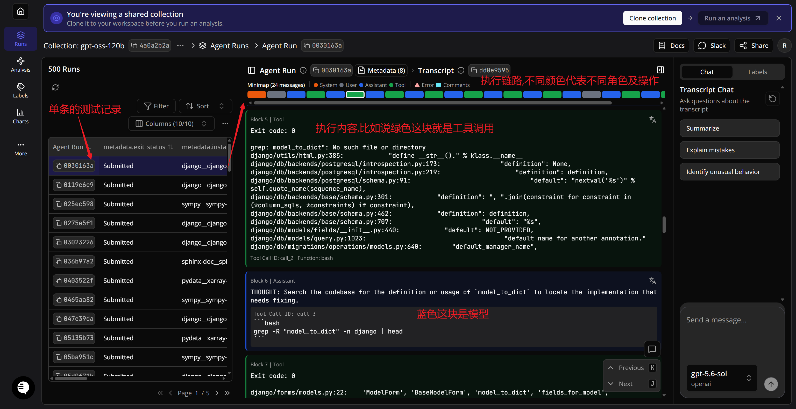

# 资源收集

记录学习中实际用到的网站，以及下次访问时可以做什么。论文和文章原文仍在 [参考资料索引](references/README.md) 维护。

| 网站 | 用途 | 使用方式与具体入口 | 示例操作 |
| --- | --- | --- | --- |
| [Docent · Transluce](https://docent.transluce.org/dashboard) | 查看、分析 Agent 执行轨迹 | 从共享集合选择一次 Run，按 System / User / Assistant / Tool 消息追踪任务、动作与反馈；先看一次完整过程，再分析失败原因。[1a 中的 gpt-oss-120b 共享集合](https://docent.transluce.org/dashboard/4a0a2b2a-a65b-452a-88c7-bb5d99745c75)。 | [查看截图与步骤](#docent查看一次-agent-执行记录) |
| [SWE-bench](https://www.swebench.com/) | 了解软件工程任务基准、查看评测结果 | 先确认 Full、Lite、Verified 等任务集与运行设置，再比较任务解决率；分析案例时结合测试和评估结果，不把执行状态 Submitted 直接视为修复成功。 | 待补充 |

后续新增网站时填写名称、用途和具体入口；有值得反复查看的案例链接时一并保留。

## Docent：查看一次 Agent 执行记录

入口：[gpt-oss-120b 共享集合](https://docent.transluce.org/dashboard/4a0a2b2a-a65b-452a-88c7-bb5d99745c75)。下图为个人标注的操作示例，记录日期：2026-10-28；界面可能随产品更新变化。

1. **左侧选择一次 Run**：每行是一条任务运行记录。`Submitted` 是退出状态，不直接代表修复成功，需结合任务评估或测试结果判断。
2. **上方 Minimap 定位消息**：颜色对应消息角色或事件；截图中橙色为 System、灰色为 User、蓝色为 Assistant、绿色为 Tool，另外还有 Error 与 Comments 标记。
3. **查看蓝色 Assistant 块**：这是模型输出，示例中包含分析文本和准备执行的 Bash 命令。模型发出调用请求，与程序真正执行命令是两个步骤。
4. **查看绿色 Tool 块**：这是工具执行后的返回结果，包括退出码、标准输出或错误信息。图中的红字将其概括为“工具调用”，更准确地说是“工具执行结果”。退出码为 0 也不保证任务完成，仍需检查输出与任务目标。
5. **沿消息顺序继续向下看**：将“模型选择动作 → 工具返回结果 → 模型决定下一步”连起来，观察它如何定位代码、修改和验证。右侧 Transcript Chat 是辅助分析入口，与中间保存的原始运行记录区分。

初次学习先追踪一个完整任务即可，不必遍历全部 500 条记录。图中 `THOUGHT` 是模型输出的分析文本，不等于模型内部完整的思考过程。
