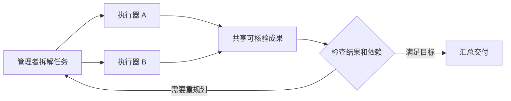

# 10b · Interaction 1: Multi-Agent Interaction：课程笔记

课件：[lecture-18-multi-agent-systems.pdf](lecture-18-multi-agent-systems.pdf)。以下按 PDF 页序整理。课件数据对应原实验设定，补充讲解用于辅助理解。

## 第 01 页｜多代理系统

Saujas Vaduguru 介绍代理如何分工、通信、协作、训练和评估。

## 第 02 页｜定义

多个代理分别决策，通过消息或共享环境影响彼此。环境更新也是通信路径。

## 第 03 页｜动机

可扩展测试时计算，也可用角色、上下文和权限边界分离职责。

## 第 04 页｜上下文管理

完整交互会累积。让子代理处理局部问题，再返回摘要和证据，可限制主上下文增长。

## 第 05 页｜预设角色

角色通常由提示和工具权限定义。适合任务结构明确、交接规范稳定的流程。

## 第 06 页｜ChatDev

虚拟软件公司按角色组织开发和沟通。复习时看每个角色接收什么、能改什么及如何验收。

## 第 07 页｜实现工作流

课件代码例子为日历代理配置相应工具，工作流将请求路由给专用代理。

## 第 08 页｜开放委派

子问题可能超出预设角色。由主代理识别何时拆分并在运行时派发。

## 第 09 页｜多代理辩论示例

用宝石数量题展示多个答案和推理。让参与者看到其他解法并尝试纠错。

## 第 10 页｜辩论结果

课件展示 Du 等的实验。收益可能来自多样候选和互相核验，比较时需与同预算独立采样对照。

## 第 11 页｜按需启动子代理

京都旅行示例从根任务分成几个独立调查项。上下文与委派深度决定信息范围。

## 第 12 页｜程序原语

用启动、传递目标、等待和收集结果等原语协调。应让子任务输入和产物可验证。

## 第 13 页｜RAO 上下文收益

子代理保留本地历史，主代理读结论和证据。错误或缺失的摘要会影响汇总。

## 第 14 页｜管理式委派

MACU 由管理者拆解、调度、检查和重规划，执行器专注环境操作。

## 第 15 页｜何时委派有收益

课件指出更长、更可并行的任务更受益。对于短串行任务，协调可能超过节省的时间。

## 第 16 页｜异步协调问题

执行时间不同的代理需处理等待、完成和重新分配，避免阻塞无依赖任务。

## 第 17 页｜CAID

管理者产出 DAG，用结构化消息协调。依赖完成后可派发下游工作。

## 第 18 页｜Blackboard

共享面板存放中间发现，各代理读写公共信息。适合多人逐步补足证据。

## 第 19 页｜等待子代理

等待期间若不能进行有用工作，会损失并行收益。可从依赖图挑选其他就绪节点。

## 第 20 页｜DeLM 去中心化

代理基于共享上下文和异步状态自主行动，减少对中央调度者依赖。

## 第 21 页｜公开任务队列

共享队列标记任务状态，代理按状态认领。需处理重复认领、超时和恢复。

## 第 22 页｜GitSwarm

以 Git 共享版本化工件和进展。可追踪贡献与变更，也需定义冲突和合并规则。

## 第 23 页｜通信收益

课件研究示例显示群体通过共享发现可优于各自探索。收益取决于进展能否复用。

## 第 24 页｜反例

Terminal-Bench 2.0 的平均准确率为单代理 pass@1 52.53%、独立 pass@2 62.36%、通信 team@2 60.67%。表中后两者最大准确率分别为 64.04% 和 61.80%。相同候选规模下，通信组未超越独立尝试。

## 第 25 页｜可验证进展

共享可复现的中间结果比只说做过什么更便于其他代理继续工作。

## 第 26 页｜其他实体导入

视角从多个工具代理扩展到与人及模拟实体互动。

## 第 27 页｜人机作为多代理

SWEET-RL 把用户和代理的多轮协作作为交互过程。用户输入可澄清目标并改变任务状态。

## 第 28 页｜用户模拟器

可提供大量多轮练习。评估模拟器需观察行为分布和与真实用户的差异。

## 第 29 页｜PPP：模拟学习

用模拟反馈训练生产力、主动性与个性化，关注何时询问或利用偏好。

## 第 30 页｜PPP：奖励

课件把总体奖励表示为生产力、主动性和个性化之和。权重会改变代理的行为取舍。

## 第 31 页｜Simulator collapse

固定模拟器易被策略反复适配，策略可能只会利用其规律，在其他用户上失效。

## 第 32 页｜多样伙伴

更换或混合不同交互对象，降低对单一行为模式的过拟合。

## 第 33 页｜涌现通信

GlossoGen 研究代理在协作任务中如何形成可共享的符号约定。

## 第 34 页｜约定的稳定性

共同使用的信号可在重复互动中产生。换伙伴或改变奖励后应检查约定能否迁移。

## 第 35 页｜目录名通信

课件案例展示目录名能承载共享信息。审计多代理通信也要看文件系统等间接渠道。

## 第 36 页｜Magentic Marketplace

开放市场环境模拟多个代理在商品、需求与沟通中的互动，可测试策略及群体结果。

## 第 37 页｜Generative Agents

小镇模拟将多个代理置于共同环境，记忆与计划影响活动和社交传播。

## 第 38 页｜训练评估导入

过渡到利用博弈测量校准、合作和判断。

## 第 39 页｜不确定性表达

代理可报告置信度或选择保留意见。评价应比较其置信度和实际正确率。

## 第 40 页｜信息寻求博弈

代理问答并按答对、答错或表达不确定获得收益。收益设计影响信息披露。

## 第 41 页｜何时保留意见

在给定奖励规则下，比较直接回答的期望收益与保留意见收益。正确校准可成为最优策略。

## 第 42 页｜信任更强的代理

问题是裁判能力有限时如何判断较强系统。辩论让不同立场提交可检查证据。

## 第 43 页｜辩论裁判实验

课件比较辩论下裁判结论。要观察是否提高事实正确率，以及说服力是否会掩盖证据不足。

## 第 44 页｜课程总结

多代理可扩大测试时计算、支持角色分工及协调。收益取决于依赖关系、信息共享质量、验证和成本。

## 结构图

以下为课件机制的复习示意。

