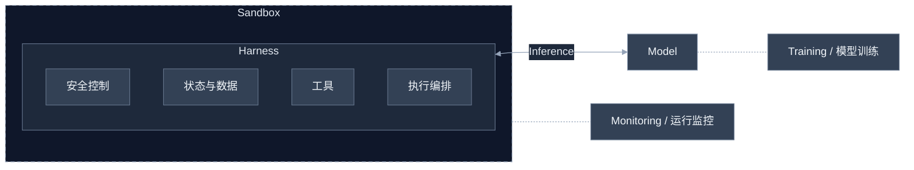

# 1a · What Is an Agent?

## 核心理解

Agent = 模型 + 执行循环 + 外围系统。模型选择动作，程序执行，环境返回反馈，再决定下一步。

## 1. 基础概念

- **Tool definition**：工具名称、用途、参数结构，供模型理解和选择。
- **Tool call**：模型生成的工具调用请求，不等于已经执行。
- **Tool result / Observation**：程序执行后返回的结果或错误。
- **Reward**：衡量任务表现的反馈，可来自测试、规则、环境或模型裁判。观察不等于奖励，执行循环也不要求每步都有奖励。
- **Next-token prediction**：根据已有上下文预测下一个 token，连续生成文本或动作请求；实际操作由程序完成。

例子：询问文件内容 → 请求 `read_file("test.py")` → 程序读取 → 返回内容或错误 → 模型回答或继续。读取通常只获取信息，写入才改变外部内容。

## 2. 执行循环与评估

任务 + 历史 → 请求模型 → 选择动作 → 执行 → 观察结果加入历史 → 下一轮。

需要终止条件：完成任务，或达到步数、时间、成本限制。

- **ReAct**：推理、行动、观察交替推进任务，是方法而非框架。
- **mini-swe-agent**：简洁的代码 Agent 实现，可参考执行循环。
- **SWE-bench**：真实代码问题与评估机制，相当于考题和判分规则。
- **Trajectory**：一次任务的完整执行轨迹。关注模型知道什么、做了什么、反馈是什么、是否据此调整。

[GPT-OSS / Docent 示例](https://docent.transluce.org/dashboard/4a0a2b2a-a65b-452a-88c7-bb5d99745c75) · [操作说明](../../RESOURCES.md) · [mini-swe-agent](https://github.com/swe-agent/mini-swe-agent)

`Submitted` 只表示提交状态，是否成功要看测试和评估。输出的分析文本也不等于模型内部完整推理。

## 3. Agent 应具备的能力

两条改进路径：**模型训练**改善模型行为，**Harness engineering**改善外围执行系统，可以结合使用。

| 能力 | 系统侧做法 | 训练侧思路 |
| --- | --- | --- |
| 准确调用工具 | 参数校验、格式约束、错误处理 | 工具调用示范数据 SFT |
| 长上下文连贯性 | 压缩、记忆检索、子任务委派 | 对应数据与训练 |
| 可定制性 | Memory、Skills、自定义工具 | 微调或 RL |
| 复杂任务管理 | 规划 → 委派 → 验证 | 多步骤决策训练 |
| 环境理解 | 领域知识、Skills、环境反馈 | SFT / RL |
| 安全性 | 权限、沙箱、工具限制、监控 | 安全训练，不能替代权限控制 |

训练术语：Pretraining（预训练）、SFT（监督微调）、RL（强化学习）。SFT 通常基于示范数据优化预测目标，RL 利用奖励反馈优化行为。Mid-training 的具体阶段划分待核对，不能直接等同于 SFT。

## 4. Agent 是系统，不只是模型



### Harness engineering

管理状态、工具、记忆和控制流；校验动作、处理错误、落实权限。

- 组成：Permissions、Memory、Tools、Control flow。
- 示例：CC、Codex、OpenHands、OpenCode、Pi；编排框架如 LangChain、CrewAI。
- 我的理解：类似后端应用执行层，连接模型决策与实际操作，改进它不必修改模型权重。

### Sandbox

隔离代码和工具执行，限制计算、网络和文件访问，提供可复现环境。

- 组成：Execution、Isolation、Resources、Access。
- 示例：Docker、Apptainer、Modal、Sail。
- 区别：Harness 管流程，Sandbox 管执行边界；隔离效果取决于具体配置。

### LM inference

可靠地提供模型生成服务，管理批处理、缓存复用、流式输出、并行和吞吐量。

- 示例：vLLM、SGLang。
- **KV cache**：复用已处理 token 的 Key/Value，减少重复计算；不是答案缓存或长期记忆。跨请求复用需要匹配前缀和服务支持。
- **Streaming**：逐步返回输出。
- **Latency**：单次调用或整个任务的耗时。
- **Throughput**：单位时间处理的请求或 token 数量。

Harness 提交输入，推理服务运行模型并返回输出；推理通常不更新权重。

### Training systems

准备数据、收集轨迹、协调分布式 workers、保存检查点、评估和复现实验。

- 示例：SkyRL、Miles。
- **Rollouts**：生成或交互轨迹，不只是最终答案。
- **Workers**：承担采样、执行、评分或更新等任务的进程或节点。
- **Rewards**：任务表现的反馈。
- **Update**：根据训练目标更新模型参数。

基于轨迹的 RL：采样 → 评分 → 更新 → 评估 → 继续迭代。训练可以调用推理服务采样；SFT 不要求同样的环境交互或显式奖励流程。

Checkpoint 用于恢复训练，通常还需优化器等状态，不等于只有最终权重。

### Observability and monitoring

采集轨迹和指标，追踪质量、成本与失败，对比不同运行和评估结果。

- 示例：Laminar、MLflow。
- 关注：Traces、Inspect、Quality、Latency、Cost。
- 我的理解：类似后端调用链、日志与监控，还要观察模型决策和反馈利用情况。

Docent 可以用来查看轨迹；发现问题后仍需验证原因，记录和监控不会自动修复错误。

## 5. 快速回顾

| 部分 | 核心问题 |
| --- | --- |
| Model | 生成什么？ |
| Harness | 如何组织和执行？ |
| Sandbox | 在哪里执行，权限和资源边界是什么？ |
| Inference | 如何提供模型计算？ |
| Training | 如何更新能力？ |
| Observability | 如何判断表现、定位问题？ |

这些职责可以集成在同一产品中，不必为每一项单独部署系统。

## 6. 来源与疑问

- [视频位置](https://www.youtube.com/watch?v=JQuI-0Yo1yw&t=1217s)；与 [课程入口](README.md) 的视频是否为同一版本，待核对。
- 论文笔记：[ReAct](../../references/papers/2210.03629-ReAct/notes.md)、[Toolformer](../../references/papers/2302.04761-toolformer/notes.md)。
- 待核对：mid-training 的原课件表述、CC 的完整名称。
- 待实践：错误工具或参数怎样处理？什么时候继续，什么时候终止？

## 7. 后续行动

已运行下述最小订单工具调用实验；下一步学习 1b，并继续验证错误参数与重复调用的处理。局部实验跑通不代表本课已掌握。

整门课的能力目标：

- [ ] Build：基于开源 LLM 从零实现 Agent。
- [ ] Evaluate：设计多步骤任务评估。
- [ ] Train：通过训练改善能力。
- [ ] Safety：分析安全与可靠性权衡。
- [ ] Research：探索一个开放问题。

课程学习状态见 [课程索引](../README.md)。


## 8. 工具调用：模型决策，后端执行

本节为个人理解与自编实验记录，整理日期：2026-10-29；不是官方课程原文或官方作业要求。

### 为什么 Python 能执行模型提出的调用？

模型生成工具名称和参数；SDK 接收响应并解析为对象；我们编写的 Python 代码读取这些字段，校验后显式调用本地函数。当前实验中 SDK 不会自动执行工具，也没有通过反射或 `eval` 将模型字符串直接变成可执行代码。

对应代码：[订单实验](experiments/ToolsInvoke.py)、[请求封装](../../src/utils/AgentInvokeUtils.py)。

```python
# 模型返回的名称只是字符串，执行器只允许已知工具。
if call.function.name != "get_order_status":
    raise ValueError("不允许调用该工具")
arguments = json.loads(call.function.arguments)
order_id = arguments["order_id"]
# 真正调用函数的是我们写下的这行代码。
result = get_order_status(order_id)
```

以上摘录突出调用关系；完整代码还校验参数结构和类型。

| 部分 | 职责 |
| --- | --- |
| 工具定义与 API 协议 | 约定工具名称、用途、参数和响应格式 |
| 模型 | 根据目标、工具说明和历史反馈，提出动作或生成回复 |
| SDK | 发送请求、接收响应，将响应解析为可读取的对象 |
| 后端执行器 | 校验动作、执行函数、管理历史、回传结果、控制终止 |

我的理解：模型像“调度大脑”，后端像“执行手脚”，同时后端还掌握最终执行权和权限边界。模型提出动作不等于动作已被批准或执行。

### 多轮交互与消息历史

```text
用户：查询订单 A001
→ 模型：请求 get_order_status，携带参数和调用编号
→ 后端：校验并执行本地函数
→ 工具结果：A001 已发货，关联原调用编号
→ 再次请求模型：携带以上完整历史
→ 模型：依据工具结果回复已发货
```

保存 assistant 的调用请求，再追加 tool 结果；`tool_call_id` 将结果与具体请求关联。若只重新发送最初的问题，模型不知道查询已经执行，更没有依据确认订单状态，可能再次请求调用。

需要区分两类上下文：上述历史保存同一次任务中的动作与观察；用户先说查订单、下一句补充订单号则属于跨用户输入的连续对话。当前 `run_order_agent` 每次调用都会新建历史，尚未实现后者。

流式仅改变单次响应的接收方式：逐块接收或完整接收。无论是否流式，当前实现都需要后端执行工具、回传结果并发起下一轮请求。`finish_reason="tool_calls"` 表示模型提出调用；`stop` 表示本轮生成结束，不保证业务任务已经完成，例如询问订单号后也会 stop。

### 执行边界与终止条件

- 工具白名单：限制可执行的函数，不能根据模型返回的名称任意执行代码。
- 参数校验：工具定义和 Python 类型注解不能代替运行时检查；JSON 字符串需要先解析为字典。
- 业务结果：订单不存在不等于工具崩溃或网络异常，不应无条件重试。当前仅校验非空字符串，不能把“查无订单”说成“订单号格式无效”。
- 权限：白名单不等于业务授权。真实订单服务还需依据可信登录身份检查订单归属；当前模拟实验未实现身份与归属校验。
- 终止：`max_rounds=4` 限制模型请求轮数，防止重复循环持续消耗资源；不是递归限制，也不保证解决重复调用的原因。一轮可有多个工具请求，所以请求轮数不等于工具调用次数。
- 提示注入可能诱导错误动作；它与通信被拦截或篡改的中间人攻击是不同概念。当前未做攻击验证。

### 已观察到的事实

以下来自本人在对话中提供的实际运行日志，订单数据均为本地模拟数据：

| 输入 | 模型请求次数 | 工具执行次数 | 工具结果与最终回复 |
| --- | --- | --- | --- |
| 查询 A001 | 2 | 1 | 工具返回已发货，模型回复已发货 |
| 查询 xxxx | 2 | 1 | 工具返回订单不存在，模型据此告知不存在 |
| 查询订单但不提供编号 | 1 | 0 | 模型询问订单号 |

这些观察支持：本实现能在上述样例中完成工具调用与结果回传，模型能够依据返回结果回答或询问缺失参数。每个场景仅记录一次运行，未统计成功率、延迟、Token 用量、成本或波动，不能推断普遍可靠性。

### 解释、局限与后续问题

- 个人解释：反馈循环让模型依据实际工具结果继续决策，而非仅凭初始问题生成答案。
- 工程联系：类似 Java 后端根据请求字段分发已有方法；这里动作建议来自模型，后端仍负责校验与执行。
- 固定工作流也能完成这个订单任务。动态选择提供了处理自然语言和不同反馈的方式，但本实验没有证明它优于固定工作流。
- 尚未验证：真实模型重复调用、参数修正、多工具调用和提示注入场景中的行为；模拟响应验证不能替代真实模型实验。
- 待思考：工具和参数都合法时，如何阻止查询其他用户的订单？如何区分暂时性故障与无需重试的业务结果？
