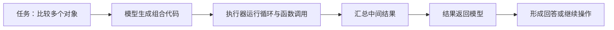
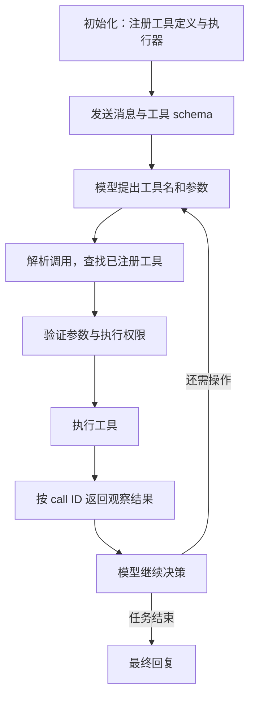
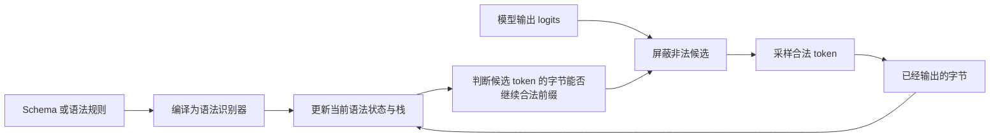
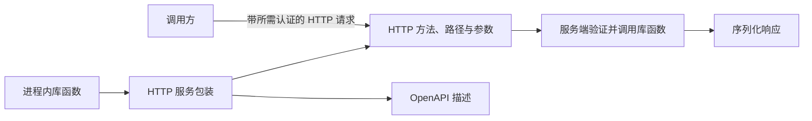
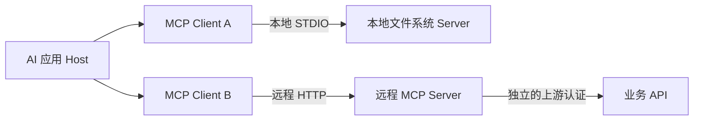
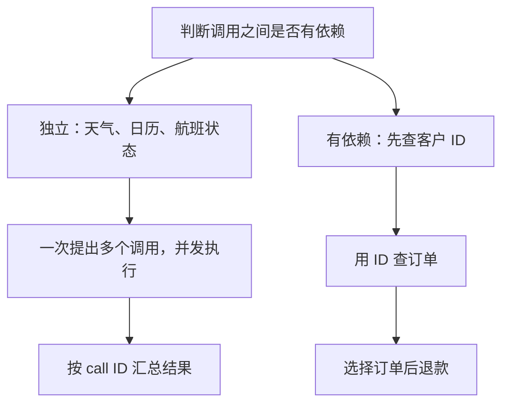

# 1b · Agent Capabilities 1: Tool Use：课程笔记

课件：[lecture-02-tool-use.pdf](lecture-02-tool-use.pdf)；本地收录日期：2026-11-04，原始文件未修改。以下按课件顺序整理，直观比喻与补充解释用于辅助理解，不代表已完成听课、论文阅读或实验。

## 工具是什么，为什么使用工具（第 2–5 页）

**工具是语言模型调用外部计算机程序的接口。模型提出请求，外部软件决定是否执行、怎样执行。** 因此，生成一段工具调用文本，本身不等于外部动作已经发生。

工具有两类主要价值：**扩展（Extend）**模型参数之外的信息和行动能力；**辅助（Facilitate）**模型，把程序更可靠或更高效的操作交给程序处理。

| 需求 | 工具例子 | 价值 |
| --- | --- | --- |
| 获取新信息 | 搜索 | 取得新证据 |
| 精确计算 | 计算器、Python | 执行明确计算 |
| 访问私有状态 | 账户 API | 读取授权范围内的数据 |
| 改变外部环境 | 浏览器、业务 API | 执行实际动作 |

是否调用工具，要权衡收益与延迟、费用、失败概率和风险，并非调用越多越好。

## 从能力需求设计工具（第 6–12 页）

从“希望 Agent 做什么”出发，再为每类交互定义清晰、范围较窄的接口。

| 接口示例 | 作用 | 注意点 |
| --- | --- | --- |
| `finish(text)` | 返回最终文本并停止循环 | 属于运行框架的控制动作，不是外部程序 |
| `search_web(query)` | 检索网页信息 | 返回内容是证据，仍需判断是否支持回答 |
| `execute_code(code)` | 在隔离环境执行代码 | 模型写代码，执行器运行代码 |
| `generate_image(query)` | 按描述生成图像 | 结果可以是文件等非文本产物 |
| `create_grocery_cart(items)` | 调用特定应用能力 | 类型化接口把业务动作封装起来 |

## 代码作为元工具（第 13–17 页）

**代码式工具调用**把循环、变量、库与多个操作组合进一次动作，减少模型在每个细碎步骤之间来回生成。课件的 CodeAct 例子用循环比较多个国家的价格、汇率、税率与运费，而非每一步都请求模型重新规划。

课件展示的 CodeAct 子集中，代码形式在 8/8 个模型上成功率最高，在 7/8 上轮次最少；全部 17 个模型中这两个计数均为 12/17。这是论文实验的课件摘录，不是“任何任务用代码都更好”的结论。

代码表达力强，但动作空间也更广，可能触及文件、网络和进程；相较窄接口，验证更困难，需要隔离、资源限制、权限控制和执行记录。

## 工具从定义到执行的机制（第 18–25 页）

### 消息、模板与调用协议

API 中的 system、user、assistant 等消息，经 chat template 序列化为模型输入的 token 序列；工具名称、描述和参数 schema 也会进入模型可见输入。模型输出调用内容，再由接口与运行框架识别、解析为结构化请求。

不同模型的调用标记和序列化协议可能不同；**相同的工具含义，不代表底层 token 格式相同**。课件列出的协议属于具体模型示例，不宜作为跨模型通用格式直接复制。

### Harness：连接模型与真实程序的运行框架

课件中的 OpenHands 流程为：初始化时解析工具配置并建立 `tools_map[name]`；每次调用时解析参数、查表、构造并验证 Action、执行 executor，再返回带调用 ID 的 ObservationEvent。图中的权限检查是对执行边界的辅助说明，不意味着参数验证能替代授权。

**call ID** 用于把结果与请求对应起来，尤其是在并行调用时；工具名字相同也不能代替唯一调用 ID。工具返回之后，模型仍可能误读或忽略结果，因此执行成功不等于任务成功。

## 约束解码：保证格式，不保证语义（第 26–35 页）

### JSON、Schema 与正确动作的区别

| 层次 | 检查什么 | 仍可能存在的问题 |
| --- | --- | --- |
| JSON 语法 | 括号、引号等是否合法 | 字段或值不符合要求 |
| JSON Schema | 类型、必填字段、枚举、额外字段 | 城市填错、工具选错、缺少授权 |
| 业务与任务语义 | 参数是否对应真实需求、动作是否合适 | 需要执行结果与任务级验证 |

例如 `units` 限定为 `C` 或 `F` 时，`{"units":"K"}` 可以是合法 JSON，却不符合该 schema；即使填 `F` 合法，也不能证明城市正确或请求已授权。

### 语法怎样约束下一个 token

**PDA（下推自动机）**由有限控制状态和栈组成：状态记录当前规则进展，栈记住对象、数组等嵌套结构应返回哪里。可把它理解为“当前读到什么位置 + 尚未闭合的括号记录”。

token 边界不等于语法边界：一个 token 可能包含 `"F"}` 等多个语法片段，也可能只包含片段的一部分，因此约束检查要处理候选 token 解码出的全部字节。

XGrammar 的课件流程是：解析已生成前缀 → 取缓存中的多数候选合法性 → 对依赖具体上下文的少数候选检查完整栈 → 合并结果并掩蔽 logits。非法候选的 logit 设为负无穷后，softmax 概率为零。

加速主要来自合法性缓存、支持分支共享的持久化栈，以及 CPU 检查与 GPU 推理的重叠；“持久化”在这里指数据结构版本共享，不是一定写入磁盘。格式约束仍不能保证事实正确、权限正确或任务完成。

## 从库函数到 REST API（第 36–40 页）

- **库 API** 是程序内接口；只有函数名、参数与类型，还没有网络地址、传输和认证。
- **REST／HTTP API** 将能力暴露为 HTTP 操作，例如 `GET /weather?city=...`，服务端处理认证、参数和响应。
- **OpenAPI** 描述 HTTP 方法、路径、参数、响应及安全方案；其中的数据结构可由 JSON Schema 描述，两者不是同一层的规范。

课件用 FastAPI 演示包装库函数并生成 OpenAPI，再用 curl 直接请求服务。示例中的天气域名、函数与代码用于说明机制，不是本仓库已运行的服务；此处不把课件 SDK 代码当作经当前版本验证的教程。

直接通过 shell 调用 REST 很灵活，但 shell 可能接触 API 凭据，因此应明确凭据由谁持有、权限范围是什么，避免把秘密混入模型可见文本或执行输出。

## MCP：面向 AI 应用的能力接口（第 41–46 页）

MCP 标准化 AI 应用如何发现和调用能力；它是工具接口的一种选择，不是调用 REST 的前提。Host 可以管理多个客户端连接，服务端提供工具，也可提供资源与提示模板等能力。

课件用 FastMCP 展示将 OpenAPI 操作投射成可发现工具：`GET /weather` 对应 `get_weather(city, units)`；这是适配思路，自动映射不意味着业务授权与工具设计可以省略。

| 对比 | OpenAPI／HTTP API | MCP |
| --- | --- | --- |
| 发现 | 获取 OpenAPI 文档 | 运行时调用 `tools/list` |
| 调用 | HTTP 方法、路径和参数 | 通过 MCP 传输调用 `tools/call` |
| 认证 | 客户端向 API 认证 | 客户端向 MCP 认证，上游认证可独立 |
| 范围 | 描述 Web API 操作 | 工具、资源、提示模板等 |

**凭据中介**：客户端使用 MCP 凭据访问服务端，服务端持有另一份上游 API 凭据；上游密钥不必交给模型或 Agent 的 shell。分离凭据提供了控制边界，但仍需正确实现认证、授权与日志；课件中的静态 token 仅用于教学／开发示例。

## 多次调用的编排与并发（第 47–51 页）

课件示意中，串行执行包含 4 次模型生成和 3 次工具等待，合计约 6.4 秒；独立调用并行后为两次生成加最慢工具，即 `2 × 0.8 + max(1.2, 0.9, 1.1) ≈ 2.8 秒`，不含额外调度开销。

**并行的前提是独立且可以安全并发**：没有参数依赖，也没有相互冲突的状态修改。结果完成顺序可以不同，但必须保留调用 ID；发生超时、异常或部分失败时，要分别处理，不能把整批结果都当作成功。

## 工具使用的评估（第 52–57 页）

BFCL 的课件示例覆盖单轮、多轮、并行、缺少函数或参数、长上下文、搜索与记忆，以及幻觉和格式敏感性；这些是课件介绍的评估维度，不是当前榜单排名。

| 层次 | 评估问题 | 典型指标／失败 |
| --- | --- | --- |
| 工具选择 | 是否选对工具，是否多调或漏调 | precision／recall，缺少或多余调用 |
| 参数 | 字段与值是否正确 | schema／AST 匹配，错误字段或数值 |
| 轨迹 | 调用顺序与依赖是否正确 | 序列成功率，先后关系错误 |
| 任务 | 用户目标是否真正实现 | 执行后的端到端成功率 |

**AST** 是抽象语法树，比较的是调用的结构，而不只字符串是否完全相同；结构匹配仍不能替代真实执行与结果验证。

还应记录效率（延迟、调用数、token、费用）、可靠性（超时、重试、部分失败）与安全性（权限、副作用、对抗性工具输出）。错误可发生在不同层：

- **模型**：选错工具、填错参数、忽略结果。
- **Harness**：解析、认证、验证失败，调用 ID 对应错误。
- **工具或服务商**：超时、限流、执行错误。

第 57 页是 2026-08-27 的服务商错误率快照；这里只保留“服务商运行故障也影响任务成功率”的结论，不把历史图表作为当前服务质量排名。

## 全课串联与复习问题（第 58–60 页）

工具使用是一套分层系统：**能力接口 → 模型生成调用 → 框架验证与执行 → 结果匹配 → 依赖编排 → 任务级评估**。工具定义得清楚、输出格式合法、程序执行成功，是不同环节的要求，任何一项都不能单独证明用户目标已完成。

可优先复习：为什么模型输出调用不等于执行？JSON 合法与 schema 合法有什么区别？约束解码为何不能代替权限检查？OpenAPI 和 MCP 分别描述什么？哪些调用可以并行？如何验证最终任务而不只验证参数格式？
