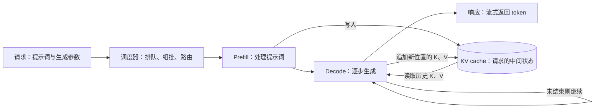
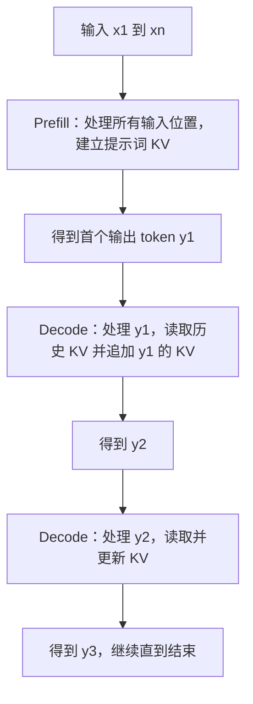
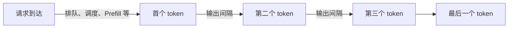
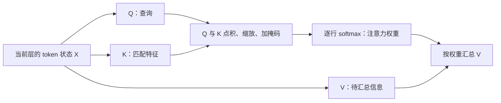
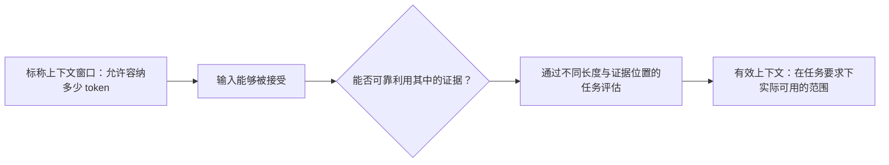
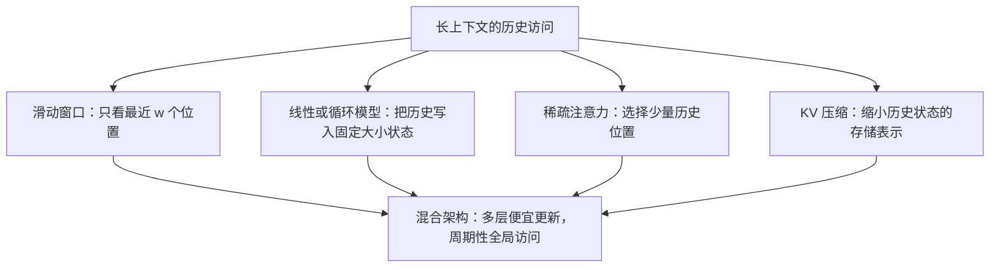
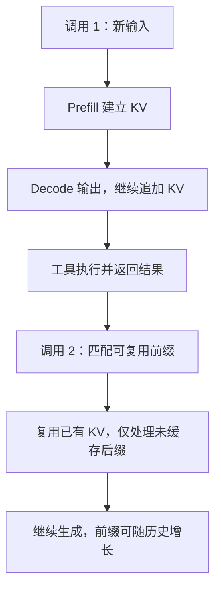
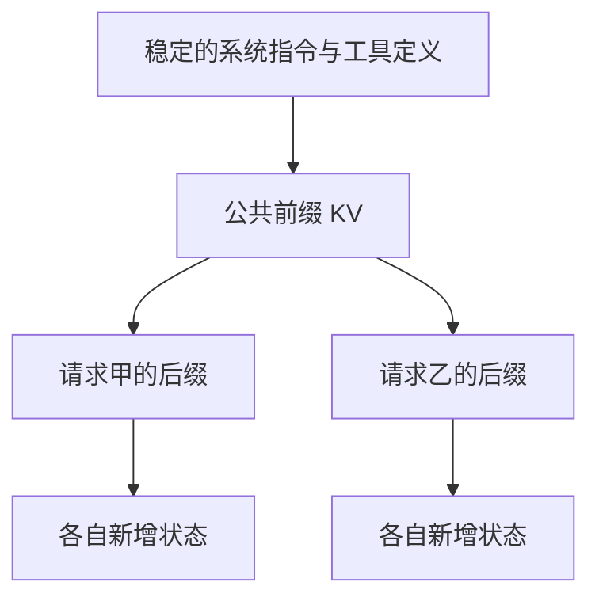
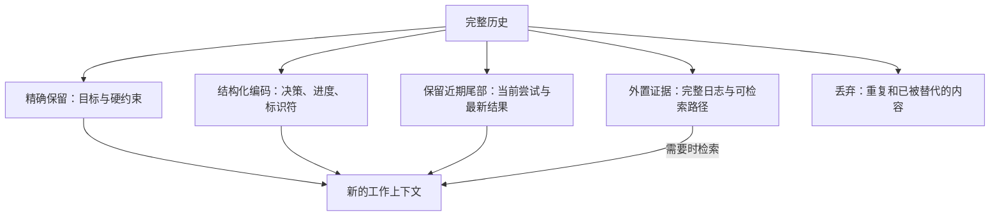
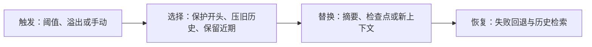

# 2a · Agent Capabilities 2: Context Management for Long-Context Agents：课程笔记

课件：[lecture-03-long-context.pdf](lecture-03-long-context.pdf)；本地收录日期：2026-11-04，原始文件未修改。以下按课件顺序整理；概念比喻与补充解释用于辅助理解，不代表已完成听课或实验。

## 历史线性增长，累计输入呈平方增长

每轮输入由固定前缀和此前历史组成；若每次保留完整历史且每轮新增长度大致固定，单轮输入线性增长，累计输入 token 数则呈平方级增长。
原因是旧历史会在后续调用中反复输入，因此上下文管理需要减少无关历史的重复携带。
这里的平方增长指累计输入 token 数，不等同于实际计算量、延迟或费用的增长规律。

## Agent 提示词的组成示例

对 1,500 个 OpenHands 会话的统计显示，每个会话平均为 77,922 token，其中系统指令与工具定义占 23%、用户内容占 9%、推理占 9%、工具调用占 20%、工具结果占 37%，另有 2% 未标注类别。
工具调用与工具结果合计占 57%，说明在这一样本中，工具交互内容是上下文的主要组成部分。

## 长上下文的两类挑战

- **容量（Capacity）**：模型能否有效利用所需证据；架构、位置编码和训练决定可用上下文能力，评估用于衡量这一能力。
- **效率（Efficiency）**：系统能否承担处理长上下文的成本；注意力机制、KV 缓存内存、缓存复用和上下文压缩影响成本与延迟。

## 模型服务流程：请求如何变成回答

以下结构图对应课件流程，文字中的直观解释用于辅助理解。

- **Request**：包含模型要读的上下文，以及控制生成的参数；不是只有用户最后一句话。
- **Scheduler**：决定请求何时执行、哪些请求一起计算、交给哪个执行实例；因此等待时间也会影响用户体验。
- **KV cache**：保存注意力层中已处理位置的 Key 和 Value，避免生成下一个 token 时重复计算这些历史状态；它不是保存完整回答的结果缓存，也不是模型权重。

## Prefill 与 Decode：先读，再逐步写

**Prefill（预填充）**相当于先读完题目：因果掩码限制每个位置只能看自己和之前的内容，但已知输入的各位置仍可并行计算；处理输入后即可预测首个输出 token。

**Decode（解码）**相当于接着逐字写答案：普通自回归生成中，下一步依赖上一步生成的 token，因此沿生成时间轴逐步执行；处理一个新 token 时读取历史 KV，并追加该位置的 KV。

| 对比 | Prefill | Decode |
| --- | --- | --- |
| 每次处理的位置 | 多个已知输入位置 | 每个序列通常一个新位置 |
| KV 操作 | 建立输入的 KV | 读取历史并追加新 KV |
| 主要特点 | 计算密集，输入越长通常耗时越大 | 顺序生成，常受内存带宽限制 |
| 用户感受 | 多久开始回答 | 开始后输出有多快 |

这些是典型特点，实际瓶颈还取决于模型、硬件、批大小和上下文长度，不能把两个阶段绝对归为单一瓶颈。

## 服务指标：等多久、输出多快、系统能处理多少

| 指标 | 含义 | 理解要点 |
| --- | --- | --- |
| TTFT：Time to First Token | 请求到达到首个 token 的时间 | 包括等待和处理，不只 Prefill |
| TPOT：Time per Output Token | 首个 token 之后，平均每个输出 token 的耗时 | 相邻输出间隔反映生成是否流畅 |
| Throughput：吞吐量 | 单位实际时间完成的 token 数或请求数 | 衡量系统总处理能力，需注明计量口径 |
| Cost：费用 | 输入、缓存输入、输出等计费项的总和 | 各项按各自数量和价格计算，不在此记录具体价格 |

若输出共 \(N>1\) 个 token，可用 \(TPOT=(t_{last}-t_{first})/(N-1)\) 计算平均间隔；总耗时约为 \(TTFT+(N-1)TPOT\)，实际流式传输还可能受网络与缓冲影响。

**直观区分：**TTFT 看“多久开始说”，TPOT 看“说得多快”，吞吐量看“系统同时服务大家的总能力”；吞吐量高不保证每个请求等待都短。

## 注意力：为什么需要 Q、K、V 和因果掩码

对某一层的 token 状态矩阵 \(X\)，通过不同的可学习投影得到：

$$
Q=XW_Q,\qquad K=XW_K,\qquad V=XW_V
$$

直观上，**Query（Q）**表示当前位置想找什么，**Key（K）**表示各位置可供匹配的特征，**Value（V）**表示匹配后要汇总的信息；这只是理解比喻，不是独立的文本检索系统。

采用常见的加性掩码写法：

$$
A=\operatorname{softmax}\left(\frac{QK^\top}{\sqrt{d_k}}+M\right),\qquad O=AV
$$

其中 \(d_k\) 是 Key 的维度；因果掩码在 \(j\le i\) 时令 \(M_{ij}=0\)，否则为 \(-\infty\)，使位置 \(i\) 对未来位置的注意力权重为零。

例如第 3 个位置可以关注第 1、2、3 个位置，但不能关注第 4 个及以后的内容；所以注意力可见区域呈下三角形。

**与 KV cache 的联系：**生成新位置时，需要用新 Q 匹配历史 K，再汇总历史 V，因此保存历史 K、V 就能复用已有计算；缓存不会让模型跳过对历史信息的注意力读取，长上下文仍会增加存储与读取负担。

## 标称上下文与有效上下文

**放得下不代表用得好：**标称上下文描述容量上限，有效上下文关注模型是否能在其中稳定找到并使用需要的信息，受任务、证据位置和评估标准影响。

课件中的 GPT-4 检索热图以横轴表示上下文长度、纵轴表示事实在文档中的相对位置、颜色表示检索准确率；部分长上下文与特定位置组合出现准确率下降，说明评估不能只看最大窗口大小。

这张图是特定实验的观察，不应推成所有模型的固定规律，也不能据此认定某个长度始终可靠。

## 长上下文架构（第 12–25 页）

### 从全局访问到混合架构

标准因果注意力让每个位置直接比较所有可见历史，长度为 \(n\) 时，成对比较数量为 \(O(n^2)\)；后续方法的核心区别是“保留哪些历史、以什么形式保留、何时访问”。

局部层便宜，但不能直接读取窗口外的原始 token；混合架构在局部或状态更新层之间加入全局层，让模型周期性访问远处信息。这里的“周期”主要指层的排列，不是每生成若干 token 才访问一次历史。

第 16 页列出多种模型的局部/全局组合，重点是这种设计思路；具体型号、层数与配比是课件实例，不作为通用架构规律。

### 四类机制及代价

| 机制 | 怎样保留历史 | 好处 | 需要理解的限制 |
| --- | --- | --- | --- |
| 滑动窗口 | 每个 query 只看最近 w 个位置 | 比较成本降为 O(nw)，固定 w 时随 n 线性增长 | 单层不能直接检索远处 token，多层传播不等于全局直接访问 |
| 线性注意力／循环模型 | 用固定形状的状态矩阵累计历史 | 状态大小不随序列长度增长 | 历史混合到同一状态，可能发生干扰 |
| 稀疏注意力 | 固定模式或按内容选择历史位置 | 减少实际参与注意力的位置 | 选择器漏掉的证据无法在该次注意力中使用 |
| KV 压缩 | 共享 KV 头或保存低维潜变量 | 降低每个位置的缓存存储量 | 不等于删除历史 token，也不自动消除全部历史访问成本 |

### 线性注意力 → DeltaNet → Gated DeltaNet → KDA

先把 \(q_t,k_t,v_t\) 看作列向量，\(S_t\in\mathbb{R}^{d_k\times d_v}\) 看作“键到值的关联记忆”。课件用简化的双线性形式说明递推，并非把 softmax 注意力原样等价改写。

| 方法 | 记忆怎样更新 | 直观理解 |
| --- | --- | --- |
| 线性注意力 | \(S_t=S_{t-1}+k_tv_t^\top\)，读取 \(o_t=S_t^\top q_t\) | 每次直接写入新关联，旧内容可能互相干扰 |
| DeltaNet | 先预测 \(\hat v_t=S_{t-1}^\top k_t\)，再写入误差 \(S_t=S_{t-1}+\beta_tk_t(v_t-\hat v_t)^\top\) | 不是重复堆信息，而是针对当前键纠错 |
| Gated DeltaNet | 先令 \(\tilde S=\alpha_tS_{t-1}\)，再基于衰减后的状态做误差修正 | 用一个标量控制整份记忆的保留程度 |
| KDA | 用对角矩阵 \(D_t=\mathrm{Diag}(\alpha_t)\) 对不同键空间通道分别衰减，再纠错 | 不同特征可以有不同的记忆寿命 |

\(\beta_t\) 控制纠错强度，\(\alpha_t\) 控制保留程度；Gated DeltaNet 令保留门为 1 时退化为 DeltaNet，KDA 各通道保留率相同时对应标量门控。固定大小状态不代表能无损保存无限历史。

### 稀疏注意力与 KV 压缩

固定稀疏模式可组合“局部窗口 + 少量全局位置”，成本较可预测；内容相关稀疏模式按 query 选择 Top-K 历史位置，更灵活但依赖选择器质量。两者都在保留的位置集合内重新归一化注意力权重。

- **MHA**：各 query 头有各自的 K、V 头。
- **GQA**：一组 query 头共享 K、V 头；**MQA** 进一步让所有 query 头共享一组 K、V。
- **MLA**：缓存压缩后的潜变量，再据此表示各头的 K、V；可理解为“保存紧凑表示”，具体实现可能融合投影计算。

**补充理解：**普通 KV cache 的存储量可粗略估计为 `2 × 层数 × token 数 × KV 头数 × 每头维度 × 每元素字节数`，其中 2 对应 K 和 V；多请求还需考虑并发与共享，MLA 等结构不能直接套用这一简单式子。

## 长上下文训练与位置编码（第 26–36 页）

### 为什么不能只调大窗口

课件给出的典型路线是短序列预训练 → 长文档继续训练 → 更长任务适配：先降低训练成本，再逐步学习远距离依赖；4K–8K、32K–128K、128K+ 是示意阶段，不是所有模型必须遵守的长度。

位置表示解决“位置与顺序怎样进入模型”，训练数据则决定模型是否真的学会使用远处证据；支持更大位置编号，并不保证长距离任务能力。

| 方法 | 核心做法 | 关键区别 |
| --- | --- | --- |
| 绝对位置编码 | 输入状态为 token embedding 加位置向量 | 学习式位置表有固定表长；正弦位置可由公式计算 |
| RoPE | 按位置旋转 Q、K，V 不变 | 点积体现相对位移，但仍有训练长度之外的泛化问题 |
| NoPE | 不显式加入位置向量或 RoPE 旋转 | 可利用因果计算或循环动态中的顺序信息，仍需学习长距离行为 |
| Position Interpolation | 扩展倍数 s=L'/L，将位置 t 映射为 t/s | 把更长位置压回熟悉的相位范围，但会改变位置区分尺度 |
| YaRN | 按频率选择性插值，并调整注意力温度 | 兼顾长距离扩展与局部区分；温度经验公式不是普适常数 |

RoPE 的简化关系为 \((R(i)q_i)^\top R(j)k_j=q_i^\top R(j-i)k_j\)，可直观看出相对距离如何进入匹配分数。

### 长上下文数据与并行训练

- **自然长资料**：书籍、代码仓库和多文档，提供连贯结构。
- **拼接样本（packing）**：提高 token 利用率，但要处理边界，避免不恰当的跨样本信息泄漏。
- **Agent 轨迹**：动作与观察序列，用于学习长程状态追踪、恢复与工具使用。
- **合成任务**：控制证据与干扰项的位置，让答案确实依赖远处信息。

课件第 33、35 页的模型案例共同强调：长资料、必须利用远处证据的任务、渐进增长的训练长度需要配合，而非只堆长文本。

**Context parallelism／Ring Attention** 把长序列的存储和工作分到多设备，并尝试重叠通信与计算；它仍可计算精确的全局注意力，并不是稀疏近似。课件的简化估计是单设备相关存储约 \(O(nd_k/P)\)，总体注意力工作仍为 \(O(n^2d_k)\)，其中 \(P\) 为设备数。

## Prompt 与 KV 缓存复用（第 37–44 页）

### 调用内缓存与跨调用复用

调用内 KV cache 避免每一步重算历史状态；跨调用的 prefix caching 则尝试复用相同前缀的状态。工具结果第一次返回时属于新输入，经处理后才可能成为下一次可复用前缀的一部分。

**缓存不缩短可见上下文：**它减少重复 Prefill，但历史仍占窗口与缓存空间，Decode 仍需访问相应状态；因此不能把缓存命中理解成历史消失了。

第 39 页强调复用可摊薄首次 Prefill 成本，但收益取决于加载、计算、硬件和复用次数；物理计算成本与 API 标价是不同量。第 40 页为课件标注于 2026-08-30 核对的价格快照，此处不抄作当前报价，仅保留“普通输入、缓存读取、输出可能分别计费，缓存创建可能单独收费”的概念。

### 缓存怎样管理与调度

| 技术 | 做法 | 解决的问题 |
| --- | --- | --- |
| PagedAttention | 逻辑 KV 块通过块表映射到不必连续的物理显存块 | 按需分配、减少连续分配造成的浪费；不是压缩 K、V 数值 |
| RadixAttention | 用前缀树组织可共享状态，匹配公共前缀，分叉处拆分节点 | 多请求复用公共前缀；空间紧张时可淘汰叶节点 |
| 缓存感知路由 | 同时考虑可复用前缀长度与工作节点队列 | 在复用收益和排队延迟间权衡 |

设计提示词时，把稳定指令、工具定义和固定示例放在前面，把新用户消息与观察追加在后面；避免无意义地更改时间戳、字段顺序等前缀内容。应实际观察缓存 token 数、TTFT 和淘汰情况，缓存命中不能仅凭文本看起来相似判断。

## 上下文压缩：保存可继续工作的状态（第 45–51 页）

### 压缩不是单纯把文章缩短

课件把 compaction 看作**状态估计**：从完整历史 \(H_t\) 提取预算 \(B\) 内的工作状态 \(\hat s_t=\mathcal C(H_t;B)\)，目标是让后续行动尽量与阅读完整历史时一致，而不是只要求摘要读起来通顺。

例如将“CI 超时 → 查看 24K 行日志 → 发现端口冲突 → 使用 `--workers=1` 后通过”压成：目标、原因、已验证配置、日志路径和下一步；这只是课件示例，不是本仓库的实验结果。

| 内容 | 推荐处理 | 原因 |
| --- | --- | --- |
| 用户目标、限制、精确版本号 | 原样保留关键锚点 | 改写可能改变任务含义 |
| 已做决策、当前进度、文件与任务 ID | 写成结构化检查点 | 防止重复劳动与对象混淆 |
| 最近的工具调用与新结果 | 保留有效的近期交互 | 方便接续当前操作 |
| 长日志、大段证据 | 保存原始材料及路径，摘要保留关键失败与命令 | 兼顾上下文预算与可恢复性 |
| 重复或过时的尝试 | 删除或简化 | 避免干扰当前状态 |

### 压缩策略的四个决策

1. **何时触发**：提前给下一次输出和工具结果留空间，不能只等完全塞满。
2. **压缩哪里**：保护目标与约束，在合法的消息／工具边界切分，避免留下孤立的调用或结果。
3. **怎样替换**：使用可读摘要、结构化检查点或服务商提供的压缩项，明确新上下文包含什么。
4. **失败怎么办**：保留原历史，定义重试或重置行为，并确保关键证据仍可找回。

### 重复压缩的漂移与评估

课件示例：`CUDA 12.4` → `CUDA 12.x` → “较新 CUDA” → 约束消失；连续“摘要的摘要”会继承并放大信息损失，因此精确锚点应复制，近期尾部应保留，必要时应回查原证据。

**评估要让 Agent 接着做事：**先在历史里放入约束、决策和产物，再执行真实压缩策略，继续任务，观察后续行动，而非只打摘要文本分。

- **状态召回**：约束、标识符是否保留正确。
- **任务成功**：能否正确继续，是否重复已经完成或被否决的操作。
- **效率**：token、延迟与成本是否改善。
- **稳定性**：多次压缩后是否仍能保留关键状态。

## 全课串联与复习问题（第 52–54 页）

**增长**解释为什么历史负担不断扩大；**推理流程**定位 Prefill、Decode 与 KV 的瓶颈；**架构**决定历史如何访问；**缓存**避免重复计算；**压缩**减少工作上下文，并保留正确继续任务的能力。

| 方法 | 主要改变什么 | 不应混淆的点 |
| --- | --- | --- |
| 架构优化 | 历史访问方式与状态表示 | 便宜不代表保留同等检索能力 |
| 缓存复用 | 已计算状态是否重用 | 不减少可见历史长度 |
| 上下文压缩 | 后续实际携带的信息 | 有信息损失风险，需要可恢复证据 |

后续复习可尝试回答：为什么窗口更大不代表证据用得更好？为什么缓存命中后 Decode 仍可能慢？固定状态如何写入、纠错和遗忘？压缩后怎样验证没有丢失真正影响行动的约束？
