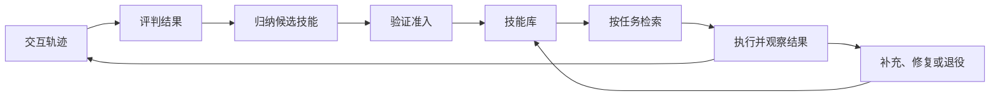

# 2b · Agent Capabilities 3: Skills and Memory：课程笔记

按[原始课件](lecture-04-memory-and-skills.pdf)的 PDF 页序记录，包含封面、章节过渡页与结束页。图表数字对应课件标注的实验。补充讲解、案例和复习问题用于帮助理解。

## 主题一：Agent 如何保留经验

### 第 01 页｜Memory and Skills

Daniel Fried 从「Agent 如何在已有经验上继续进步」引出本课。持续使用 Agent 时，很多知识在两次会话之间依然有效，例如仓库审查标准或网站搜索流程。本课关注如何把这些知识保存下来、在恰当的时候加载，以及何时更新它们。

### 第 02 页｜不同任务共享哪些步骤

两项任务分别是将索尼耳机加入愿望单、查询无线键盘的价格区间。两者共用打开商店、找搜索框、填写关键词和提交搜索。前者随后选择具体商品并加入愿望单，后者比较价格并报告最小值和最大值。

**核心概念｜共享子程序。** 将关键词抽象成参数后，共享前缀可独立保存，任务特有的后续步骤留给调用方。本课围绕三个问题展开：用什么形式表示、如何归纳、怎样维护。

### 第 03 页｜上下文、外部工件与权重

| 更新位置 | 获益 | 代价 |
| --- | --- | --- |
| 上下文窗口 | 保留当次交互的原始细节 | 输入增长，噪声多，需要决定保留什么 |
| 外部工件 | 可查阅、编辑、检索和迁移 | 需要提取、选择并持续维护 |
| 模型权重 | 改变默认行为，推理时可少携带显式说明 | 更新较慢，行为难追溯，依赖具体模型 |

**补充讲解。** 眼下就要复查的错误日志适合留在上下文。长期有效且会改动的团队规则适合外部保存。同类行为需要成为模型默认能力时，可考虑 SFT。

### 第 04 页｜Episode、Fact 和 Skill

- **Episode（经历）**保存完整动作及观测，便于复查具体价格、商品或操作次序。
- **Fact（事实）**保存可复用的陈述，例如商店只在商品详情页展示价格。事实会随环境变化，需要更新。
- **Skill（技能）**保存可重复执行的行动模式，例如填写搜索框、提交并打开结果。

**补充讲解。** 同一经历可同时产出多类记录。保留「如何操作」和「当时看到了什么」各有用途，排查问题时还可由提炼后的条目回溯原始记录。

### 第 05 页｜记忆与技能的交集

课件按两个维度区分。**记忆**强调信息来自 Agent 自身的交互，例如上次买的商品。**技能**强调信息能指导行动，例如人工编写的发布检查表。Agent 从几次成功搜索中抽取的搜索流程同时属于两类，称为**归纳技能（induced skill）**。

### 第 06 页｜技能从哪里来

人工编写以现有专长、制度和文档为来源，意图与来源清楚，成本是专家的编写和维护时间。Agent 归纳以交互轨迹与结果为来源，适合需要探索才知道怎么做的任务，成本转移到判定、验证和整理。

## 主题二：人工编写的技能

### 第 07 页｜Authored Skills

章节过渡页。接下来先看人已经知道怎样做的任务，如何把操作说明变成可维护、可选择加载的技能包。

### 第 08 页｜把反复输入的审查要求做成技能

课件以 Python PR 审查为例，固定要求包括 Black 的 88 字符行宽、Ruff 自定义规则、公开 API 类型注解、Google 风格 docstring，以及新增函数的 pytest 检查。相同规范也可以用于测试编写、依赖升级等重复工作。

**原理。** 把说明、检查脚本和参考资源放在一起，项目规范集中维护。用户每次只需提供当前任务和变更内容。

### 第 09 页｜技能包与渐进披露

**核心概念｜Progressive Disclosure。** 启动时提供 SKILL.md 的 YAML 元数据。选中技能后加载 Markdown 正文。脚本、文档、数据或模板只在相应步骤读取。课件以 `python-review/` 下的 SKILL.md、scripts、references 与 assets 示范目录组织。

**补充讲解。** 描述相当于检索入口，要让 Agent 从任务措辞判断适用场景。正文应给出决策与步骤，低频或很长的规则可放在参考文件里按需读取。

### 第 10 页｜技能索引怎样进入模型上下文

课件展示 HermesAgent 系统提示中的分类索引，按代码质量和工作流列出 `python-review`、`submit-task`、`release-notes` 等条目。模型依据名称和描述选择是否通过 `skill_view` 读取正文。这是课件中的提示示例。

**原理。** 匹配发生在模型看到正文之前。索引过短可能漏匹配，描述过宽会让无关技能也进入上下文。

### 第 11 页｜逐轮加载的代价

Hermes 示例中，系统提示先携带约 3k token 的技能索引。接着 `skill_view('python-review')` 把审查步骤送入上下文，终端运行检查脚本后只返回 Black、Ruff 的结果。需要处理 docstring 时，再加载相应参考文件。作业 1 中对应的工具是 `invoke_skill`。

**补充讲解。** 执行一个脚本可以只暴露结构化结果，因此机器可验证的检查可以用代码承担，模型集中处理解释和决策。

### 第 12 页｜SkillsBench 的对照实验

课件报告基准覆盖 8 个领域的 87 个真实工作任务，使用 18 种模型与 harness 配置。人工为任务配对技能，主实验比较无技能与精选技能两种条件。

**原理。** 这个对照回答「提供适合的技能后是否更容易成功」。要测实际部署收益，还应观察 Agent 自行选择技能的命中情况。

### 第 13 页｜收益与副作用

课件报告精选技能把平均通过率从 **33.9% 提高到 50.5%**。配 1–3 个技能的任务比配至少 4 个的任务提升更大，正文较短的分组也有较大提升。87 个任务中仍有 13 个受到负面影响，原因可能是技能干扰了本来有效的策略。

**补充讲解。** 分组趋势体现相关性。验证「删短正文会不会改善同一任务」需要固定其他条件后重新比较。

### 第 14 页｜内置、安装与生成

技能可以随框架附带、由人编写并存于 `.agents/skills/`、从仓库或注册表安装，也可由 Agent 生成。课件举例说明 Hermes 的 `skill_manage` 可维护技能，OpenHands 的技能创建入口可把刚完成的流程整理为草稿。课件建议用已跑通的流程起草，再测试几次并视情况人工审阅。

### 第 15 页｜维护代码审查技能

OpenHands 案例按「运行并记录 → PR 合并后评估 → 汇总失败 → 修订 SKILL.md」迭代。模型评判器查看人最终保留了哪些建议，案例中反复出现忽略仓库约定（约 15%）和放过严重缺陷（约 10%）。修订方向包括发现严重问题时请求修改，以及发布建议前对照仓库。

**补充讲解。** 人类采纳是有用的代理指标，也受审查者时间和偏好影响。可另留一组已知缺陷的 PR，检查修改技能后是否能发现关键问题。

## 主题三：事实、教训与经历

### 第 16 页｜Memories: facts, lessons, and episodes

章节过渡页。后续分别讨论外部存储、事实更新、把失败转成教训，以及检索整个交互轨迹作为示范。

### 第 17 页｜MemGPT 怎样管理外部记忆

图中有限窗口内包含系统指令、可读写的工作上下文和 FIFO 消息队列，模型生成内容进入输出缓冲区。函数执行器可访问归档存储，队列管理器关联会话历史存储。例子通过搜索历史中关于 Six Flags 的消息，按需把找到的记录带回上下文。

**核心概念｜主动换入。** 模型通过函数读写外部存储。窗口维持有限的当前工作集，旧信息仍可从外部找回。

### 第 18 页｜Mem0 的记忆冲突处理

| 操作 | 触发条件 |
| --- | --- |
| ADD | 找不到相似的既有记录 |
| UPDATE | 新消息改变已有记录 |
| DELETE | 新消息否定已有记录 |
| NOOP | 信息已保存或与记忆无关 |

**补充讲解。** 保存时间和来源能帮助判断「地址换了」与「一次临时配送使用另一地址」的区别。相似性可用来召回候选，是否覆盖还要结合上下文判断。

### 第 19 页｜Reflexion 从错误中提取反馈

流程是尝试、评估、生成语言反思，再重试同一任务。课件历史问答案例中，第一次回答一场战役，反思发现问题要求的是一系列战役，于是改答对应战役群。

**核心概念｜语言反馈。** 单个分数只描述成败，反思可指出下一次应改变的判断，例如先识别问题要求的答案粒度。

### 第 20 页｜检索相似轨迹作 few-shot 示范

ExpeL 等方法保存完整成功或失败轨迹，有时先重写或加注释。候选可以来自离线采集、持续使用或人工编写。新任务到来时，按文本嵌入找相似经历，连同当前请求送给模型。课件也列出 Agent S、Synapse 和 ICAL。

**补充讲解。** 一份具体轨迹可同时展示动作和环境反馈，代价是长且可能携带过时界面细节。失败轨迹需明确标记失败节点和适用教训。

## 主题四：从经验归纳技能

### 第 21 页｜Inducing Skills

章节过渡页。接下来从完整轨迹中识别可复用片段，并比较文字工作流与可执行函数。

### 第 22 页｜搜索流程如何被其他任务调用

「搜索某商品」把 `{query}` 填进输入框再提交。「报告价格区间」可复用相同片段，之后才读取结果中的最低价和最高价。课件的动作示例还包含具体的元素 ID。

**原理。** 归纳需要识别片段的输入、前置条件与完成状态。页面元素 ID 若随会话变化，复用时应重新定位或把 ID 当作参数。

### 第 23 页｜技能归纳与程序归纳的研究脉络

- **Voyager** 在 Minecraft 中逐步构建函数库，新技能可调用旧技能。
- **DreamCoder** 从已解程序里提取能压缩程序库的函数，后续搜索再使用它们。
- **Stitch** 用符号压缩快速寻找程序共享结构。
- **LAPS** 让自然语言任务描述参与函数发现与程序搜索。
- **LILO** 先由 LLM 写程序、再由 Stitch 压缩，最后由 LLM 给函数命名和写说明。

**原理。** 抽象的价值来自多任务复用。新函数若能把重复子树换成短调用，既能压缩已有解，也可缩短后续搜索。

### 第 24 页｜在线归纳的评测协议

任务逐个到达。完成加入愿望单的任务后可保存搜索技能，后续搜索游戏配件、查询无线键盘价格时可调用积累的技能。评估观察到目前为止的累计成功率。

**补充讲解。** 任务顺序会影响哪些技能已存在。复现实验应记录任务顺序、起始记忆和跨任务读写规则。

### 第 25 页｜归纳技能的完整生命周期

课件分为学习、使用、维护。学习从经历出发，经判定、归纳和准入后写入记忆。使用时先选择，再执行并收集结果。维护按结果补充、修复或退役。

### 第 26 页｜AWM 归纳文字工作流

任务要求统计提到 satisfied 的评论。原轨迹进入 Marketing 的 All Reviews，输入关键词并搜索，最后回复数量。判定终态正确后，模型用 few-shot 提示提取搜索评论这一子程序，把具体关键词替换为 `{term}`。报告数量由当前任务处理。

### 第 27 页｜AWM 的归纳提示包含哪些约束

课件展示 AWM 附录的提示：输入是自然语言任务与动作序列，输出应是跨任务重复的子程序，每个至少两步，避免近似或重叠的工作流，将变化的输入和按钮名写成含义明确的变量。

**补充讲解。** 把「搜索评论」和「统计搜索结果」分开，可独立重组技能。多个近似技能则会增加检索歧义和维护成本。

### 第 28 页｜跨任务积累如何反映在曲线上

AWM 图以已遇到的样例数为横轴、累计成功率为纵轴。示例任务从地点名称、坐标、路线、邮编扩展到驾驶时长及组合需求。课件标注在 40 个样例后，AWM 相对基线的差距为 **22.5 个百分点**。

**原理。** 早期任务可以建立原语，后续任务以这些原语组成更复杂流程。该差距来自图中的特定顺序与任务设置。

### 第 29 页｜文字示例与可执行代码

文字工作流示范如何进入分类、填关键词并点击搜索，Agent 每次仍须发出底层动作，遇到不同界面可现场调整。代码技能 `search_product(search_box_id, query)` 封装点击、填入和回车，可在入库前执行测试，也可被其他技能调用。

**核心概念｜执行粒度。** 一个函数调用可替代多轮模型决策。封装越具体，对界面变化越敏感，例如原来的下拉控件换成侧栏后，旧函数可能无法完成任务。

### 第 30 页｜ASI 如何从同一经历归纳代码技能

课件将评论任务拆成 `open_marketing_reviews()` 和 `search_reviews(search_box_id, search_button_id, search_term)`。第一段导航到评论页，第二段完成关键词搜索。重新组合两段，再提交结果。准入评判检查终态和技能是否实际被调用。

**原理。** 验证复用时需要能观察到调用路径。即使同题成功，也可能是 Agent 绕开候选代码后完成的。

### 第 31 页｜SkillWeaver 的代码检查与执行测试

流程为提出候选、实际练习、按动作和截图判断结果，再入库或修订。例子中 lint 发现药片识别函数声明了 `color` 参数却未使用，修订后让脚本选择界面中的颜色选项。

**补充讲解。** Lint 可发现参数无效，功能测试还要检查不同颜色是否导致预期的筛选结果。两种检查覆盖不同错误。

### 第 32 页｜改地址案例中的任务压缩

ASI 购物网站案例要改账单地址和配送地址。无记忆轨迹反复浏览并填写字段，在 **50 步上限**处停止。代码技能把导航到地址设置和更新两个地址封装成动作，示例用 **4 个 Agent 步骤**完成。

**原理。** 图中的步骤是外层 Agent 决策粒度。一次代码技能调用内部可执行多个浏览器操作。

### 第 33 页｜ASI 的聚合结果

| 配置 | 达到检查点 | 每任务平均 Agent 步数 |
| --- | ---: | ---: |
| 无记忆 | 41.3% | 24.5 |
| 文字技能 | 59.5% | 20.6 |
| 代码技能 | 80.2% | 15.0 |

课件数值取自五个 WebArena 网站的平均结果，体现重复结构任务下的检查点完成度和决策步数。检查点完成度可以记录部分进展，整项任务成功率需要按其独立定义统计。

### 第 34 页｜跨网站迁移失败的原因

课件把 WebArena 学到的排序技能用到 Target。原函数预期点击下拉菜单，目标站点通过侧栏排序。

**原理。** 目标语义可以跨站共享，界面动作需要适配。迁移时可用任务目标作为接口，把控件发现和点击留在站点实现里。

### 第 35 页｜PolySkill 的抽象接口

图中抽象购物类定义搜索、加购与结账等原语，并用它们组合「找到商品后加入购物车」等高层技能。Amazon 和 Target 分别实现原语，高层组合可复用。

**补充讲解。** 排序从菜单改为侧栏时，只需更新站点实现，前提是抽象方法对输入、输出和完成条件的约定仍成立。

### 第 36 页｜怎样选择表示方式

| 表示 | 擅长 | 局限 |
| --- | --- | --- |
| 检索完整经历 | 还原具体行为与反馈 | 较长，难直接迁移 |
| 文字技能 | 给模型灵活指引 | 底层动作仍要由模型逐步发出 |
| 代码技能 | 可执行、可组合，减少决策步骤 | 依赖环境和接口，容易随界面变化失效 |

设计时先决定哪些判断必须在现场由模型处理，哪些步骤可以固定并用程序测试。

## 主题五：评估、检索和维护

### 第 37 页｜The Skill Lifecycle

章节过渡页。后续逐一讨论失败怎样进入记忆、评判不完美时的表现、检索数量以及长期维护。

### 第 38 页｜ReasoningBank 从失败提取策略

课件要求列出索尼蓝牙耳机及价格区间。模糊搜索返回 5,578 条跨部门结果，每页 12 条，Agent 持续翻页直到步数耗尽。归纳出的策略包括缩窄关键词、增加单页展示数量，以及先用侧栏分类过滤。

**原理。** 失败轨迹可提供反例。归纳时把具体症状和相应修正写成有触发条件的策略，便于在新任务中识别同类问题。

### 第 39 页｜失败经历对三种表示的影响

| 方法 | 只用成功轨迹 | 加入失败轨迹 |
| --- | ---: | ---: |
| Synapse | 40.6% | 41.7% |
| AWM | 44.4% | 42.2% |
| ReasoningBank | 46.5% | 49.7% |

课件图为 Gemini 2.5 Flash 在 WebArena 购物任务中的比较，无记忆基线为 39.0%。失败数据给归纳策略提供了明显收益，直接保存经历或提取工作流的变化较小或为负。

**补充讲解。** 失败样例转成行动指导时需要说明哪里失效、该怎样替换。直接作为模仿样例时，模型可能复制导致失败的动作。

### 第 40 页｜评判器准确率的影响

实验用模拟评判器替代真实评判器，以固定概率翻转正确标签，覆盖从完美判断到随机猜测。图中评判准确率为 100% 时，任务成功率为 52.4%，90% 时为 49.7%，50% 时为 47.6%。结果表明收益随判断质量变化，课件所列配置在多种质量下仍有收益。

**补充讲解。** 随机翻转便于控制实验，实际评判器可能集中误判某类任务。排查时应拆开看假阳性、假阴性及错误集中在哪些环境。

### 第 41 页｜检索过多的成本

ReasoningBank 购物案例中，检索 0、1、2、3、4 个经历分别得到 **39.0%、49.7%、46.0%、45.5%、44.4%** 的成功率。课件指出部分经历可能无关，模型也可能难以同时利用多条经验。SkillsBench 对人工技能看到类似现象。

**原理。** 候选召回和最终注入可分开。先找可能相关的条目，再按任务相似性、环境版本和冲突去重选出少量内容。

### 第 42 页｜TroVE 怎样淘汰低频函数

TroVE 在使用次数低于 `0.5 × log₁₀(n)` 时淘汰函数，其中 n 为已见样例数。课件展示在 MATH Algebra、HiTab 和 GQA 上，带遗忘的函数库分别缩小约 74%、83%、50%。

**补充讲解。** 低频是维护信号之一。罕见但关键的恢复流程可另设保留条件，常用却持续失败的技能则需要修订或暂停。

### 第 43 页｜怎样训练负责归纳的 Agent

第一次搜索成功只能评判当前任务。要判断保存搜索技能是否值得，需要第二个任务复用它。SAGE 将两个相关任务放入同一 rollout，AgeMem 将记忆操作放进长轨迹。课件的 SAGE 奖励在第一任务回报上增加「两题都成功且第二题调用了该技能」的奖励项。

课件报告 AppWorld test-normal、Qwen2.5-32B 的场景完成指标依次为 **55.4、56.6、60.7**，分别对应仅结果、两题均成功、成功复用。这个设计让后续任务的效果反馈到早先的保存决策。

### 第 44 页｜讨论：什么值得长期保留

课件要求从完整经历、事实、教训、文字技能和代码中选择，并讨论怎样取舍四组问题：细节与通用性、灵活指引与固定执行、复用与探索、新增与合并删除。

**补充案例。** 店铺换版后，旧轨迹可保留用于故障回溯，搜索方法可留作文字技能，依赖旧控件的执行函数则可修复后重新测试。

### 第 45 页｜人和 Agent 分别负责哪些记忆决策

| 决策 | 人更适合介入的条件 | Agent 可承担的条件 |
| --- | --- | --- |
| 创作或归纳 | 规则和制度已有明确责任人 | 技能要通过交互探索 |
| 核验与入库 | 高风险或需要规范判断 | 有廉价且可执行的结果检查 |
| 选择与使用 | 少见例外依赖情境判断 | 路由经常重复并有反馈 |
| 维护 | 需要明确问责和所有者 | 可从运行结果发现漂移并测试修复 |

### 第 46 页｜回顾与下一课

末页为问答并预告 Planning。可用购物案例复习三个设计决定：保存何种经验、下一次如何检索、验证失效后怎样修订。下一课接着讨论如何用这些能力安排更长任务的行动顺序。
