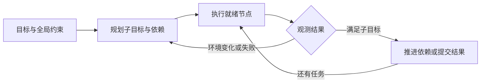

# 3a · Agent Capabilities 4: Planning, Task Decomposition, and Multi-Agent Coordination：课程笔记

课件：[lecture-05-planning.pdf](lecture-05-planning.pdf)。以下按 PDF 页序整理。课件数据对应原实验设定，补充讲解用于辅助理解。

## 第 01 页｜课程主题

Daniel Fried 讨论怎样显式安排未来行动，以及怎样分工、利用环境反馈和协调执行器。

## 第 02 页｜采购反例

反应式 Agent 串行调查四家供应商，历史从 128k 压到 14k。只有 D 满足要求但需 20 周，仍提交申请。Wiki 中 4U 与每槽 1600 W 的条件应贯穿筛选和提交。

## 第 03 页｜依赖图

供应商搜索可并行，兼容性检查依赖规格与 Wiki，申请是有副作用的下游步骤。候选不合适时可新增第五家，体现任务图会随结果改变。

## 第 04 页｜Plan Mode

只读调查、澄清、写计划、人工审查、执行。收益可能来自更好的上下文、推理预算、分解、持久化或批准，各因素可单独比较。

## 第 05 页｜计划定义

**计划**是对本次任务的未来行动、子目标及依赖的显式提案。技能可跨任务复用。计划可审查，也可根据现场反馈修订。

## 第 06 页｜课程地图

本课覆盖任务分解、重规划和计划工件。Coding Agents 介绍固定工作流，交互课展开委派与人工澄清，搜索课研究候选未来。

## 第 07 页｜先分解再行动

章节过渡。将问题拆成可验证的小目标，先确定哪些可以独立求解、哪些要读上游结果。

## 第 08 页｜思维链

逐步思考与先制定计划的提示都给模型草稿空间。计划和答案在同次生成中出现，后续 token 能条件化在草稿上。STaR、DeepSeek-R1 展示训练也可改变此行为。

## 第 09 页｜Least-to-Most

先写子问题，再依次回答并将答案传下去。局部问题需要的上下文较少。较长问题中收益更明显，也要防止错误答案沿依赖传播。

## 第 10 页｜Decomposed Prompting

把查询 1910 年出生的制片人所制作的电影奖项拆成查人、查作品、查奖。不同 handler 可用各自的示例和训练数据改进。

## 第 11 页｜计划作用于环境

章节过渡。接下来用实际工具操作说明状态变化、失败和恢复如何进入计划。

## 第 12 页｜推理与行动

推理草稿可继续修正，工具行动可能改变环境或不可逆。行动后观测应进入下一步判断，提交或发送前可检查权限与目标状态。

## 第 13 页｜STRIPS

**经典规划**用谓词表示状态，动作定义前置条件和效果。拿起积木要求其在桌面且顶部和手均为空。示例先移走蓝块，再拿橙块堆叠到蓝块上。

## 第 14 页｜隐式世界模型

自然语言计划容易写得合理，但其世界假设需要观测验证。设计关注动作适用性、执行检查与失败恢复。

## 第 15 页｜计划表示

形式化计划易检查，语言计划表达灵活，程序可调用感知和控制 API。Code as Policies、ProgPrompt 与 Binder 展示程序如何组合模型和工具。

## 第 16 页｜决策时机

开发者可固定流程，模型也可执行前选定步骤，或看到四家供应商均不理想后新增搜索。**重规划**用额外计算和控制复杂度换取适应性。

## 第 17 页｜规划的四类价值

模块化、反馈、长程控制与分权。各自解决子任务分工、对环境变化的反应、状态累积和高影响动作的审批。

## 第 18 页｜采购中的四类需求

分头查价、失败时增补搜索、持久化约束与进展、提交前审批。全局要求可通过共享的结构化采购记录传递。

## 第 19 页｜UGround

GPT-4o 用自然语言描述动作，独立训练的 7B 执行模型映射到像素坐标。规划和视觉定位可用不同数据训练。

## 第 20 页｜Plan-and-Act

教师模型先对成功轨迹分段、标注高层计划，再以标注数据分别微调 planner 和 executor。

## 第 21 页｜固定角色

验证者权限过窄时可能无法定位自己发现的故障。交接摘要也会漏掉环境信息。分工时要考虑验证所需工具及可回溯工件。

## 第 22 页｜SayCan

**Affordance**估计在当前状态能否完成技能。SayCan 结合语言模型对技能的相关性评分与机器人技能成功概率，为候选重新排序。

## 第 23 页｜环境反馈

LLM-Planner 图中找不到土豆但看到冰箱，计划改为打开冰箱。找不到回收桶但看到垃圾桶后再次修改。补充讲解应先验证替代对象是否满足原意。

## 第 24 页｜测试时预算

可在同等预算下比较更长 CoT、多候选和更多环境交互。完成后暂停复查能获得仅推理无法提供的证据。

## 第 25 页｜Overthinking

课件归纳分析停滞、偏离任务的动作链和过早放弃。这些模式与较低的 issue 解决率相关。复查应能减少某个具体不确定性。

## 第 26 页｜格式解析实验

分隔符三种、引号两种、跳过表头行数两种，共 12 种组合。文件名只提供线索，试解析可检验假设。

## 第 27 页｜Calibrate-then-Act

提示给出格式概率。例如分号可能性约 0.85，模型仍可运行测试。**校准**把置信度和失败代价纳入动作选择。

## 第 28 页｜Vending-Bench

最多 2,000 条消息、约 2,500 万 token 和 222 个模拟日。把到期日误作已交付导致过早补货，并进一步误判运营状态和扣费。定期重新观测可阻断错误延续。

## 第 29 页｜执行时域

单步准确率提升可显著延长任务。若每步独立且概率为 p，n 步全对概率为 p 的 n 次方。实际 Agent 会受到自身错误历史影响。

## 第 30 页｜模型规模与自我条件化

课件图中更大模型执行较长任务，但部分模型在注入错误后下降也更明显。RL 能否修复此现象属于研究问题。

## 第 31 页｜RAO 递归委派

将调用子代理建模为动作，子代理可继续分解。对自身任务及子节点完成情况评分。课件报告中等难度训练后，在难题上会使用更深的委派树。

## 第 32 页｜计划和注入边界

开放式下一步选择会让网页内容影响行动。固定程序可限定行动种类，仅让页面提供数据。补充讲解仍需校验数据能否安全进入参数。

## 第 33 页｜人工审查

Cursor 演示持久化计划供用户编辑和审批。重点核对目标、条件、可验证产物和不可逆动作。

## 第 34 页｜TravelPlanner 全局约束

航班、住宿、餐饮与景点可分别调查，预算、交通和饮食跨节点。汇总时须统一检查组合可行性。

## 第 35 页｜MACU 导入

过渡页。多代理电脑操作结合前面的任务图、执行反馈、长程状态和分权。

## 第 36 页｜ACL 医生检索

Odysseys 示例从搜索到核对官方个人资料，再把数据表粘贴进 CryptPad。第 76 步只达到 2/6，显示生成文件后仍有内容与呈现检查。

## 第 37 页｜ACL 任务后半段

核对姓名、机构、专长、手术确认和链接，汇总高频机构，保存表格并确认恰好十名医生各有官方标签页。第 93 步达到 6/6。

## 第 38 页｜MACU 调度

Manager 建 DAG，调度器把就绪节点派给虚拟机池中的 CUA。执行器回报后，Manager 可以继续、修订图或汇总。

## 第 39 页｜并行演示

PDF 静态画面显示旧金山天气、餐厅与营业信息并行查找，标签页整理及最终汇总等待上游节点。视频时长约 23 秒。

## 第 40 页｜跨基准比较

OSWorld 43.8% 到 48.5%，Online-M2W 52.2% 到 55.6%，WebTailBench 20.8% 到 29.5%，Odysseys 8.5% 到 34.0%。课件实验中长任务的增幅最大。

## 第 41 页｜固定执行器

OSWorld 36 题，Qwen3.5-4B 单代理 25.0%。Opus、Sonnet、GPT-5.4、Gemini、Kimi 作为管理者时分别为 58.3%、52.8%、44.4%、41.7%、41.7%。

## 第 42 页｜固定管理者

Opus 4.6 下，Qwen3.5-4B 从 25.0% 到 58.3%，Qwen3.6-27B 从 47.2% 到 66.7%。应区分执行器基线和组合后的提升。

## 第 43 页｜并行度

Odysseys 45 个较易任务中，1、2、4 个执行器耗时 25.4、13.1、7.9 分钟，成功率为 53.3%、48.9%、60.4%。应分别测量延迟和质量。

## 第 44 页｜修订图的预算

预算 0、1、5、10 对应 25.0%、27.8%、47.2%、58.3%，每题成本 0、0.08、0.41、0.46 美元。可优先在新证据改变关键依赖时重规划。

## 第 45 页｜Closing

过渡到设计检查与开放问题。

## 第 46 页｜规划检查表

确定是否可分工、需要什么反馈、如何阻止错误累积、哪些权限隔离，以及谁批准不可逆动作。

## 第 47 页｜开放问题

通用计划校验、何时思考或观察的校准、跨任务全局约束及训练能吸收多少框架职责都待研究。

## 第 48 页｜结尾

问答并预告 Coding Agents。下一课可将子目标与验收条件对应到定位、修改和测试。

## 结构图

以下为课件机制的复习示意。

