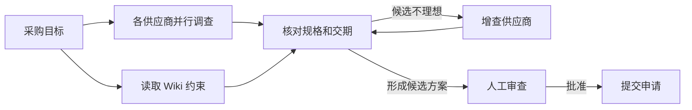
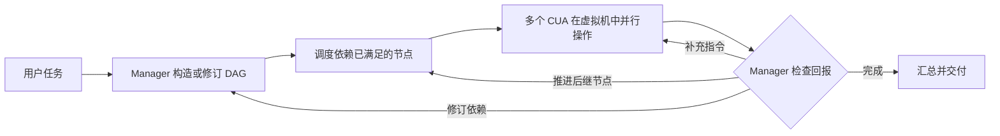

# 3a · Planning, Task Decomposition, and Multi-Agent Coordination

课件：[lecture-05-planning.pdf](lecture-05-planning.pdf)。页码对应本地 PDF。实验数据来自课件，补充推导和工程示例单独标注。

## GPU 工作站采购：从串行历史到任务图（第 2–3 页）

课件中的反应式 Agent 依次调查四家供应商，把配置、报价和页面历史放进同一个上下文。内部 Wiki 给出了两项硬件约束：机架接受 4U 机箱，每槽提供 1600 W。执行过程中上下文从 128k 压缩到 14k token，最终只有 D 满足规格，但交货需 20 周。Agent 考虑过增查供应商，最后仍提交了申请。

把任务组织成图后，四家报价可以独立收集，兼容性检查需要合并候选规格与 Wiki，申请提交依赖最终选型。若候选都不理想，计划可增添供应商 E，并让 E 接受同样的筛选。提交会改变采购系统状态，课件将它放在人工审批之后。

**补充理解**：2a 关注如何控制历史体积。这一课还关注哪些信息需要在任务间流动。分支可输出结构化的配置、报价、交期和证据，汇总节点直接读取这些结果及全局约束。

## 计划定义与 Plan Mode（第 4–6 页）

**计划**是针对当前任务的未来行动提案，写明动作或子目标，以及必要的顺序和依赖。技能提供跨任务的做法，例如怎样调查配置。本次查哪几家、何时增查属于计划。计划可以外部保存，由用户审查，也可根据环境反馈改写。

编码 Agent 的 Plan Mode 在课件中表现为只读调查 → 澄清 → 写计划 → 人工审查 → 执行。这个流程同时增加了信息收集、推理预算、显式分解和用户介入机会。若要判断书面计划本身有什么收益，补充理解是固定调查与推理预算，再比较有无计划工件。

本课聚焦分解、重规划和计划工件。固定编码工作流、角色通信、人工澄清以及候选计划搜索在后续课次展开。

## 先分解再求解（第 8–10 页）

| 方法 | 分解如何发生 | 下一步依赖什么 |
| --- | --- | --- |
| Chain-of-Thought / Plan-and-Solve | 在一次生成中写推理草稿或解题计划，再继续回答 | 后续 token 读取草稿，流程中没有独立检查阶段 |
| Least-to-Most | 第一阶段写子问题，第二阶段依次求解 | 把已求出的子答案传给依赖它的下一问 |
| Decomposed Prompting | 分解器生成子任务，并按类型派给处理器 | 处理器读取所需上游结果，可用各自的示例或训练数据 |

**Least-to-Most 滑梯题**：每轮爬上去 4 分钟，滑下来 1 分钟，15 分钟后关闭。先算一次往返 5 分钟，再用这个子答案算出 3 次。课件指出，局部问题所需上下文更少，引用实验中的收益随问题长度增加。补充理解是上游答案也是下游的前提，错误会沿依赖传递。

**Decomposed Prompting 电影题**：先找 1910 年出生的人，再查这些人担任制片人的电影，最后查获奖记录。查人、按角色查电影和查奖项各有不同的输入与输出，可以分别改进处理器。课件也用 STaR 和 DeepSeek-R1 说明推理过程可通过训练改进。

## 从推理文本到环境行动（第 12–16 页）

推理草稿可以继续修正。工具操作可能观察到新信息、失败或产生不可逆效果。计划因此需要考虑动作是否适用、执行后应看到什么、失败时如何恢复。

**STRIPS 与积木世界**：状态用谓词表示。拿起积木 x 要求 x 在桌上、顶部为空且手为空。执行后新增 holding(x)，并移除 x 在桌上及手为空两个状态。若蓝块在橙块上，而目标是橙块在蓝块上，先卸下蓝块，放到桌上腾出手，再拿起橙块并堆到蓝块上。每一步的效果为后一步建立前置条件。

LLM 容易写出语言上合理的计划，执行时仍要确认计划隐含的世界状态。例如准备提交表单前，需检查目标记录是否存在、当前会话是否有权限、提交后的确认状态是什么。

| 表示 | 能力与检查方式 |
| --- | --- |
| 形式化计划 | 用明确的动作模型检查前置条件、效果、可达目标 |
| 自然语言计划 | 方便表达开放目标和例外，适用性需要通过审查和观测判断 |
| 程序 | 能运行、检查分支并调用感知或控制 API，表达范围由接口决定，接口也可调用神经模型 |

课件以 Code as Policies、ProgPrompt 和 Binder 说明程序表示。决策可由开发者提前固定（查预设名单），由模型执行前承诺（先选供应商），也可在执行时调整（发现交期不合适就增查）。提前承诺更容易预测成本，重规划需要反馈足以影响后续决策。

## 模块化：规划、定位和执行怎样分工（第 17–22 页）

课件后半段围绕四个价值展开：模块化便于分工，反馈用于更新计划，长程控制用于跨步骤保留状态，权限分离用于控制高影响操作。

- **UGround**：GPT-4o 读屏后用自然语言描述下一步，独立训练的 7B 执行模型将描述映射到像素坐标。两个模块可用不同数据训练，一个负责动作意图，一个负责视觉定位。
- **Plan-and-Act**：教师模型将成功轨迹分段，为各段标注高层目标和对应低层动作。课件图还展示从种子计划扩充合成查询与计划。标注将任务、计划与具体动作配对，再用于训练 planner 和 executor。
- **固定角色的代价**：验证者如果无法定位故障，就可能只有报告权限而缺少复查能力。摘要也可能丢失接手者需要的上下文。补充理解是交接时保留可回查的测试输出或源文件，给验证者必要的查询能力。

**SayCan** 将候选技能的语言相关性与当前状态下的技能成功估计相乘。若目标是把苹果放到桌上，放苹果和语言指令高度相关，但当前没有拿到苹果时，先找苹果的综合分数会更有优势。这里的 affordance 是“当前环境允许成功执行什么”，可联系经典规划的前置条件理解。

## 反馈：思考、观察与重规划（第 23–27 页）

**LLM-Planner** 示例先要求烹煮土豆并放入回收桶。执行器找不到土豆却看见冰箱，计划加入打开冰箱等动作。之后找不到回收桶，计划改用垃圾桶。补充理解：前一次修订改变搜索路径，后一次还可能改变交付条件，需要判断替代物是否符合任务原意。

**Test-Time Interaction** 在近似匹配计算预算下对比增加单步 CoT、采样多个候选和增加环境交互。课件图的横轴为每条轨迹 token 数（对数尺度），纵轴为任务成功率。重叠预算区间内，交互扩展取得较高的成功率。完成后重新查看页面或工件可以获得新的状态证据。

**Overthinking** 归纳了分析停滞、偏离目标的动作链与过早放弃。课件报告过度思考评分与较低的 issue 解决率相关。补充理解：复查可绑定一个具体问题，例如运行覆盖争议路径的测试来确认修改是否生效。

**Calibrate-then-Act** 实验中，文件格式由 3 种分隔符、2 种引号、2 种跳过表头的行数组成，共 12 种组合，三项全对才能解析。文件名提供线索，课件将格式先验作为额外提示。模型看到分号概率约 0.85，仍可试解析或跑测试确认。先验影响先尝试什么，验证成本与错误后果影响何时采用该结果。

## 长程执行：错误会进入后续决策（第 28–31 页）

**Vending-Bench** 要求 Agent 长时间管理定价、订货和补货，课件给出的上限约为 2,000 条消息、2,500 万 token 和 222 个模拟日。示例中 Agent 将“今天应到货”当成“已到货”，提前补货。环境准确报告当前无库存，Agent 却推断生意已经失败。由于它没有等待交付邮件或重新查看库存，随后将每天正常收取的费用理解为停业后的未授权扣费。

这是**自我条件化（self-conditioning）**的例子：旧的推断被留在历史中，成为下一个判断的输入。补充理解是区分预期交付时间、系统确认状态和模型推断，在关键决策前重新检查外部状态。

**执行时域（execution horizon）**关注多少步可以保持可靠。简化推导中，每步独立且成功率恒为 p，连续 n 步全对的概率是 pⁿ。100 步任务的单步成功率从 99% 提高到 99.9%，全对概率约从 36.6% 提高到 90.5%。实际 Agent 会受到已生成历史的影响，课件图中注入错误后后续准确率下降。其模型规模实验显示更大模型能执行更长任务，部分较大模型也对注入错误更敏感。强化学习能否减轻这种影响是开放问题。

**RAO** 把委派实现为 launch_subagent(goal) 动作，子 Agent 可以继续递归委派。节点评分考虑自身任务结果及子节点成功情况。课件图显示，用中等难度任务训练后，难题上的执行轨迹往往形成更深的委派树。

## 控制：页面数据、人工审查与全局约束（第 32–34 页）

**安全边界**：课件任务要求把 200 美元以下最好的降噪耳机加入购物车。网页评论可插入“忽略价格”之类的指令，影响能自由选择下一动作的 ReAct Agent。程序可以从网页读取价格和评价，通过受约束的 API 执行筛选及加购。补充理解是页面参数还需验证类型、范围和对应商品。

**人工审批**：Cursor 演示允许用户编辑和批准持久化计划。采购场景可以在推荐候选和提交申请之间审查实际要写入采购系统的配置、报价及交期。

**TravelPlanner**：航班、住宿、餐饮、景点可分头搜索，预算、交通衔接和饮食约束贯穿整个计划。补充理解：单独合格的航班和住宿组合后仍可能超预算，或因抵达时间晚于入住窗口而不可行。最终应检查组合。

## MACU：多 Agent 电脑操作如何调度（第 35–39 页）

**Odysseys 的 ACL 医生检索**要求找出十名纽约市医生，通过官方资料确认其可提供所要求的膝关节手术，并保留对应标签页。第 76 步已将数据粘贴至 CryptPad，但验收只达到 2/6。后续逐项核对机构、专长、手术确认和直接链接，汇总高频机构，保存表格，并检查人数及标签页的对应关系。第 93 步达到 6/6。

DAG 是有向无环图，边表示前置依赖。第 39 页的视频预览显示旧金山天气、餐厅评价与营业时间等可以并行查询，标签页整理及汇总需要等上游结果。

## MACU 实验：成功率、耗时与预算（第 40–44 页）

| 基准 | 单 Agent | MACU | 增幅 |
| --- | ---: | ---: | ---: |
| OSWorld | 43.8% | 48.5% | 4.7 个百分点 |
| Online-M2W | 52.2% | 55.6% | 3.4 个百分点 |
| WebTailBench | 20.8% | 29.5% | 8.7 个百分点 |
| Odysseys | 8.5% | 34.0% | 25.5 个百分点 |

四个基准中，Odysseys 的增幅最大。对照医生例子，可以看到长任务里同时存在可独立查询的分支和需要统一验收的交付条件。

- **固定 Worker（第 41 页）**：OSWorld 36 题，Qwen3.5-4B 基线为 25.0%。Opus 4.6、Sonnet 4.6、GPT-5.4、Gemini 3.1 Pro、Kimi-K2.6 分别作 Manager 时，成功率为 58.3%、52.8%、44.4%、41.7%、41.7%。
- **固定 Manager（第 42 页）**：Opus 4.6 下，Qwen3.5-4B 从 25.0% 到 58.3%，提升最大。Qwen3.6-27B 从 47.2% 到 66.7%，最终成功率最高。读图时要同时查看基线、增幅与最终值。

| Odysseys 较易子集（45 题） | 1 个 Worker | 2 个 Worker | 4 个 Worker |
| --- | ---: | ---: | ---: |
| 实际耗时（分钟） | 25.4 | 13.1 | 7.9 |
| 成功率 | 53.3% | 48.9% | 60.4% |

4 个 Worker 的耗时约为单 Worker 的三分之一，成功率先降后升。补充理解：并行主要缩短独立分支的等待时间，整个任务仍受最长依赖链和汇总工作的影响。

| 图修订实验的规划预算 | 0 | 1 | 5 | 10 |
| --- | ---: | ---: | ---: | ---: |
| 成功率 | 25.0% | 27.8% | 47.2% | 58.3% |
| 图示每题成本（美元） | 0.00 | 0.08 | 0.41 | 0.46 |

第 44 页横轴是 **Planning Budget**，表示配置的预算。图中预算与成功率同向增加，成本按该图的口径记录。

## 复习与开放问题（第 46–48 页）

| 设计问题 | 用采购任务复述 |
| --- | --- |
| 子任务能否独立，模块是否值得专门化？ | 四家可独立检索，兼容检查需要规格和 Wiki |
| 哪些反馈触发重规划？ | 候选交期均不合适就增查，证据不足则重新核对 |
| 怎样阻断错误与上下文累积？ | 持久化已核实的事实、约束和进展，提交前复查 |
| 哪些权限要隔离，谁批准不可逆操作？ | 搜索分支只收集资料，由有权限的环节在审批后提交 |

课件提出四项开放问题：自然语言计划与子目标图如何通用校验，如何校准何时思考、观察、询问或修订，怎样维护跨分支的全局约束，以及训练能吸收多少框架职责。下一课进入 Coding Agents。
