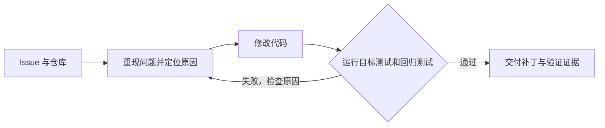

# 3b · Domains 1: Coding Agents：课程笔记

课件：[lecture-06-coding-agents.pdf](lecture-06-coding-agents.pdf)。页码对应本地 PDF。实验结果按课件给出的设定记录，标为“补充理解”的内容用于推导或解释。

## 从代码补全到软件开发（第 1–3 页）

课程区分三个任务层级。**单次补全**给定提示，交付一段代码。**仓库级修复**给定 issue 和已有代码，可能跨文件定位、修改和运行测试，交付补丁与验证证据。**软件开发**还要处理需求、评审、发布和后续维护，前一次交付会影响后续任务。

编码 Agent 的三个组成部分是提示、模型和工具。提示说明目标与约束，模型决定下一步操作，工具读取仓库并执行动作。测试失败会通过工具返回给模型，改变下一轮判断。工具所暴露的操作和返回信息会影响同一个模型可完成的任务。

## 代码模型如何学习语法、接口与长依赖（第 4–13 页）

| 阶段 | 训练内容 | 要解决的问题 |
| --- | --- | --- |
| 预训练 | 在源码、文档、网页、数学等混合语料上预测后续 token | 学语法、接口、惯用法及文本与代码的配合 |
| 中期训练 | 继续语言建模，调整代码比例，加入更长且相关的输入 | 强化代码能力并让模型读取跨文件依赖 |
| 后训练 | 用指令、推理与执行结果等信号训练 | 生成符合规格且可通过验证的程序 |

预训练时要保留缩进、文件边界和文本与代码的关系，并按领域观察留出集损失及功能任务成绩。清洗包括过滤损坏或低价值内容，去除 fork、内嵌依赖和复制解答的重复，保留许可证与来源记录。按仓库或题目家族切分并做评测去污染，可减少测试样本的近重复落入训练集。

**分词**可以用在代码和自然语言上学习的 byte-level BPE。标识符可能跨多个 token，空格、制表符和换行有时属于语法或字面量。第 9 页的 StarCoder2 示例里，换行及后续部分缩进可合并成一个 token。StarCoderBase 例子为 15.5B 参数、1T token、80 多种语言，语料还含 issue、commit 和 notebook。第 10 页图中，多数语言的 pass@1 随训练 token 增长。

**中期训练的配比取舍**。Code Llama 从 Llama 2 出发，为 7B、13B、34B 模型继续训练 500B token。课件还列出 Qwen2.5-Coder 的配比对照：

| 代码 / 文本 / 数学 | Common code | MATH | MMLU |
| --- | ---: | ---: | ---: |
| 100 / 0 / 0 | 49.8 | 10.3 | 23.8 |
| 70 / 20 / 10 | 48.3 | 33.2 | 62.9 |

这组实验里，混合配比的代码分略低，数学和通用分数明显较高。选择比例时应同时观察目标任务和其他能力的变化。

**长上下文要提供可用关系**。课件例子中，`types.py` 定义 `Result.value` 可能为 None，`worker.py` 传递 Result，最后需要在 `caller.py` 补空值检查。相关文件及路径要进入同一可理解的序列。课件给出的 Qwen2.5-Coder 示例是训练长度从 8K 到 32K，再用 YaRN 扩展至 128K。对应的验证应包括跨文件补全、中间填空及短上下文能力。

## Infilling：让缺口右边的代码也参与补全（第 14–18 页）

给定 `def is_positive(x: int) -> ____:`，右侧已存在 `return x > 0`，模型可据此补出 `bool`。**中间填空**把缺口两侧作为条件，适合补代码、推断类型或编辑已有文件。

InCoder 的课件示例把原串 `prefix span suffix` 重排为 `prefix [M0] suffix [M0] span [END]`。训练时模型先见到缺口位置与后缀，再学习生成被移到末尾的片段。推理时提供到第二个 `[M0]`，然后生成缺失片段。多个缺口可用不同标记对应各自位置。

| HumanEval 衍生填空任务 | 后缀如何使用 | 单行通过率 | 多行通过率 |
| --- | --- | ---: | ---: |
| 左到右，1 个候选 | 无 | 48.2% | 24.9% |
| 左到右，10 个候选 | 只用于重排 | 54.9% | 28.2% |
| 因果掩码填空 | 生成时直接读取 | 69.0% | 38.6% |

第 17 页还比较相同 52B token 预算下的普通补全。左到右目标在 HumanEval、MBPP 的 pass@1 为 6.0%、8.9%，因果掩码目标为 8.0%、10.9%。这是课件引用的目标消融，说明这一实验中填空训练也保留了单向补全能力。

其他监督来源分别提供不同信号：提交信息与修改前后教编辑，诊断信息与错误代码教修复，测试结果可产生奖励，执行轨迹记录实际经过的代码行和状态变化。

## 评估生成代码：表面相似度与行为测试（第 19–27 页）

正整数判断的课堂例子同时说明两类误差。`x >= 0` 与参考 `x > 0` 文本很近，却在 x = 0 时返回错误结果。`not (x <= 0)` 字面差别较大，对整数却满足同样的规格。

| 指标 | 衡量对象 | 如何解读 |
| --- | --- | --- |
| Exact match | 候选与参考文本是否一致 | 适合要求复现的任务，等价实现可能失分 |
| BLEU-4 | 最长 4 元的 token 片段重叠，并考虑长度惩罚 | 小的符号改变也可能造成大的行为差异 |
| CodeBLEU | 普通及加权 n-gram、AST 结构、数据流的加权组合 | 增加结构信息，分数仍基于与参考的匹配 |
| CodeBERTScore | 对提示与代码编码，用上下文 token 向量的最佳匹配计算 precision、recall 和 F-score | 可衡量较软的相似性 |
| 执行测试 | 运行候选并检查输出或状态 | 可以接受不同实现，结论受测试覆盖和运行环境限制 |

对 `x >= 0` 分别输入 −1、0、1，期望是假、假、真，实际是假、真、真。0 这个边界点定位了错误。执行验证需要可信测试、依赖以及隔离运行，通常还要约束时间和内存。

**HumanEval** 是 164 道 Python 函数题，从 docstring 补函数并跑隐藏单测。**CodeContests** 从竞赛题描述生成完整程序，再编译或运行用例。**pass@k** 衡量 k 个采样候选中至少一个通过全部测试的概率。补充理解：如果候选独立且单次通过率固定为 p，该概率为 1 − (1 − p)ᵏ。课件中的 oracle 重排代表知道哪些候选可通过时的选择能力，实际交付还取决于可用的检查或排序方法。

**非功能需求**也要明确验证口径。提速要在输出正确的前提下计时，再算 speedup。课件的 NoFunEval 包括 397 个编辑任务，其中参考改动相似性可用 DiffBLEU，部分可维护性或安全任务结合 CodeQL 与编辑匹配。这些量衡量的属性不同。

## 执行奖励怎样训练代码推理（第 28–30 页）

DeepCoder 的训练循环是：对同一问题采样带推理与最终代码的响应 → 执行最终代码 → 将通过或失败转成奖励 → 更新模型并再次采样。测试信号直接对应代码的可观察行为。

课件用 0 ≤ n ≤ 10¹² 的求和题说明规格中还有规模约束。`sum(range(n + 1))` 在大输入下太慢，端点配对推导出常数次算术操作 `n * (n + 1) // 2`。若误写成 `n * (n - 1) // 2`，输入 n = 1 已足以发现错误。

读 LiveCodeBench 图时要区分训练和推理预算。16K → 32K 指 RL 阶段响应 token 上限变化，64K 星标是在评估时给更多 token，未继续做 RL。橙色虚线是 o3-mini 参照。分数变化对应图中的模型、任务和预算。

## 仓库级闭环：定位、修改、验证（第 31–37 页）

任务是修复“重试次数设置为 0，运行时却按 3 次处理”。先沿配置流查调用点，再重现失败。课堂实现的问题在于：

```python
return config.get("retries") or 3
```

Python 的 0 为假值，缺失、None 和显式 0 都会选到默认值。修复点是将选择默认值的条件收窄到 None：

```python
value = config.get("retries")
return 3 if value is None else value
```

| 验证 | 预期 | 目的 |
| --- | ---: | --- |
| 显式设置 0 | 0 | 重现并确认目标修复 |
| 配置缺失 | 3 | 保留缺省行为 |
| 配置为 None | 3 | 保留空值默认行为 |
| 显式设置 2 | 2 | 保留普通配置 |

课件先用 `rg 'retries' buggy_config.py` 定位，再用单测重现 3 != 0。修复后运行 `python3 -m unittest -v test_config`，课件结果是 4 项通过。若目标用例仍失败，应沿着 loader、默认值计算和调用者继续定位值在哪一步变化。



**Agentless** 代表固定流程：从文件定位细化到类、函数及编辑位置，生成候选补丁，再用重现测试和验证步骤过滤、排序。这与 3a 的决策时机相连。流程先确定，模型在阶段内做判断。工具循环则能根据任意中间结果再搜索或调整编辑。

## 工具既影响编辑，也影响定位（第 38–45 页）

| 工具或编辑方式 | 输入与返回 | 适用性 |
| --- | --- | --- |
| Shell-only | 模型给命令，环境返回输出、退出状态或超时 | 一个入口支持搜索、脚本编辑和测试。课件示例是 mini-SWE-agent |
| 整文件写入 | 路径和完整内容 | 应用直接，长文件需要重传大量未修改内容 |
| Search / replace | 路径、旧片段和新片段 | 比整文件紧凑，需要旧片段可唯一定位 |
| Unified diff | 文件路径、行位置与上下文 | 标准补丁形式，Aider 示例省略 hunk 行号 |
| 文件操作补丁 | 创建、更新或删除的操作以及上下文 | 课件展示 Codex 的操作标记形式，更新片段可用上下文定位 |

Shell 可调用 `rg` 搜索、用 sed 或 Python 编辑，并跑测试。Aider 的 89 道 Python 重构任务中，同一个 GPT-4 Turbo 模型用 search/replace 成功率为 20%，用简化 unified diff 为 61%。任务包括把大类中的方法移到顶层并保留代码。数据说明接口格式在该实验中显著影响结果。

定位时，关键字命中可能同时出现在参数定义、配置加载和重试循环。需要跟踪“0 第一次被读到”和“0 变成 3”之间的路径。LocAgent 的依赖图思路可将定义、调用者、测试及消费者放在一个相关邻域中，再用执行结果验证因果假设。

## 仓库修复的评测、训练与任务生成（第 46–54 页）

**SWE-bench** 将 issue 与代码库作为输入，Agent 交付补丁，评测框架应用补丁和测试，运行并记录结果。**Fail → Pass** 检查目标行为是否恢复，**Pass → Pass** 检查已有行为是否保留。对应重试例子，0 是目标修复，正数和默认行为是回归保护。

**SWE-Gym** 强调先建成能运行的任务：仓库起点、依赖、测试命令、带复现的 issue 和验收检查。第 50 页展示两个扩展方向：训练时增加轨迹数量，推理时执行多条候选轨迹并用学习到的验证器选补丁。两种方式增加的成本发生在不同阶段。

**R2E-Gym** 以完整修复轨迹做强化学习。搜索、编辑、测试和结束由 Agent 决定，文件内容、补丁结果和测试输出作为后续上下文，终局用修复成功与否给奖励。终局失败无法直接指出是定位错了、代码写错了，还是验证不足，因而存在信用分配问题。

**SWE-smith** 从能运行测试的真实仓库出发，保留环境镜像并修改实现，确认旧测试产生新的失败，再将缺陷、描述与验证结果打包成任务。课件用重试规则演示：正常实现 4 项通过 → 改为按假值取默认后 3 通过、1 失败 → 恢复实现后 4 通过。

**跨语言与跨 harness**。Python、TypeScript 和 Rust 项目分别从 `pyproject.toml`、`package.json` 或 `Cargo.toml` 等配置确定测试入口。Harness 包括提示、工具、Agent 循环和上下文管理。同一模型可在 OpenHands、OpenCode、Codex 等框架下收集轨迹，用补丁测试奖励更新共享权重。课件以 Nemotron 3 Ultra 和 Polar 说明如何覆盖多个框架以及让原生框架接入同一模型接口。

## 前端修复要验证交互和渲染（第 55–59 页）

课堂例子是联系人表单允许全空格姓名。定位到组件和保存事件处理器，将校验从 `value.length` 改为 `value.trim().length`。浏览器中输入空格并点击保存，应出现可读的错误提示且记录数仍为 0。换合法姓名后还应能保存。

| 检查方式 | 能回答的问题 |
| --- | --- |
| 浏览器 Agent 逐步观察和操作 | 页面结构未知时，找控件、探索流程、判断下一步 |
| Playwright 脚本固定操作与断言 | 复现输入、点击和保存检查，方便重复验证 |
| 截图检查或基线比较 | 错误是否出现在合理位置、提示是否可见可读 |

SWE-bench Multimodal 可在 issue 里提供图片，用来说明缺陷。补丁仍可用执行测试验收，例如检查空白姓名触发错误、无新增记录以及合法输入仍能保存。

## 软件开发任务的产物和验证时域（第 60–72 页）

实施循环中的测试通过后，软件仍可能要经历评审、部署、生产监控、回滚和维护。课件引用 5,928 个 Microsoft 员工自报工作日，阅读与编写代码及测试约占 15%，其余时间包含沟通、调试、测试、评审、需求和文档等。这个比例对应所引用样本。

| 任务 | 课件示例 | 交付物与验证 |
| --- | --- | --- |
| 代码定位 | CodeScout | 输出文件、模块和函数，在三个层级上与参考补丁位置计算 F1。参考补丁用于评分 |
| 应用创建与扩展 | ViBench | 从零创建、扩展参考 MVP、扩展 Agent 先前交付的 MVP，分别用人工编写的浏览器测试计划检查 |
| 库实现 | Commit0、ProgramBench | 前者在骨架上实现函数并跑集成包测试，后者可通过探测参考可执行程序来核对可观察行为 |
| 连续维护 | SWE-Milestone | 保留已修改的代码库状态，任务按依赖解锁，逐里程碑执行测试并检查回归 |
| 测试生成 | SWT-Bench | 写出旧版失败、修复版通过的测试。两版都通过的测试没有区分目标缺陷 |
| CI 修复 | LCA CI Builds Repair | 以实际工作流验证修改。课件例子是 Node 16 低于依赖要求的 Node ≥18，更新 CI 的 Node 版本后重跑安装、构建和测试 |

SWT-Bench 的课堂图示用尾随换行重现缺陷：若规范只允许字母和数字，`isValid("name\n") == False` 应在缺陷版失败、修复版通过。正常名字的用例在两版都通过，可作为回归检查。

**SWE-Playground** 从项目提案拆出任务，建立仓库骨架与函数桩，生成测试，根据测试实施功能，再把项目转化为 API 使用、缺陷修复、测试设计或库实现等练习。衡量能否迁移时，应使用留出的仓库和任务，并匹配推理预算。

| 第 72 页选录的任务 | 基础 32B | Hybrid-Gym 32B |
| --- | ---: | ---: |
| SWE-bench Verified 修复 | 7.00% | 32.40% |
| SWT-Bench Verified 测试生成 | 9.01% | 16.86% |
| Commit0 Lite 库构建 | 8.34% | 13.45% |

这些成功率由各任务分别定义，适合在同一行比较训练前后的变化。

## 代码世界模型：预测有什么用，何时要真实执行（第 73–79 页）

**策略**根据历史选择动作，如在看完代码后决定跑测试。**世界模型**根据历史与候选动作预测观测，如预测测试会触发什么断言。真实执行提供可用来纠正预测的观察。

```python
items = [1]
alias = items
alias.append(2)
result = len(items)
```

真实执行后，`items` 和 `alias` 都引用同一个列表 [1, 2]，`result` 为 2。预测若把别名当作副本，就会错误估计后续状态。课件进一步展示两个候选修复：模型误预测正确的 A 会失败、错误的 B 会成功，因而可能提前丢弃 A。运行候选可以直接验证这项预测。

**CWM** 的课件流程包括通用预训练、以代码世界建模为目标的中期训练、监督微调，以及面向推理和 Agent 操作的联合强化学习。**GIF-MCTS** 的图示则用环境描述生成可执行的候选世界模型，用采集到的真实轨迹验证。预测出错就反馈修订，满足检查后用于规划。

评估预测时要同时看预测误差、实际任务成功率、总延迟、token 和真实调用次数。还要用留出的程序、依赖和环境检验泛化，并比较不同回退阈值下节省的执行与引入的失败。

## 复习：用同一个 issue 检查整条链（第 80–82 页）

用“重试 0 次却变成 3 次”复述：先找从配置到调用者的值传递，再修复默认值判断，用 0 确认目标行为恢复，用缺失、None 和正数检查回归，最后交付补丁和验证证据。若把这个例子改成训练任务，则要提供可运行环境和明确奖励。若让模型预测测试结果，则要核对预测能否改进候选选择，并在关键验证处获得真实执行反馈。下一课进入 GUI Agents。
