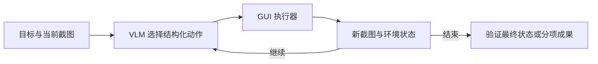

# 4a · Computer Use Agents：课程笔记

课件：[lecture-07-computer-use-agents.pdf](lecture-07-computer-use-agents.pdf)。以下按 PDF 页序整理。课件数据对应原实验设定，补充讲解用于辅助理解。

## 第 01 页｜课程导入

JY Koh 介绍 Computer Use Agent，覆盖 GUI 循环、评估、模型、训练与部署。

## 第 02 页｜CUA 定义

代理以渲染界面为观测，用点击、键入等改变应用状态。可操作缺少专用 API 的界面。

## 第 03 页｜观察、推理、行动

**Observe–Reason–Act** 将用户任务和观测交给模型，模型给动作，基础设施执行，再把新观测送回。

## 第 04 页｜蓝杯示例的目标

用户要买蓝色杯子，颜色是硬条件。模型须先从当前屏幕找到可执行的搜索入口。

## 第 05 页｜蓝杯示例的动作

同一示例展开一个动作和观测。代理应依据执行后的界面决定下一步，避免假定提交一定生效。

## 第 06 页｜蓝杯示例的历史

用户目标、先前动作和新观测共同决定当前候选。只看孤立截图可能遗漏已满足的条件。

## 第 07 页｜蓝杯示例的中间状态

搜索或打开商品只是部分进展。验证要进一步检查商品颜色、价格等任务约束。

## 第 08 页｜终止和奖励

循环持续到任务结束，然后用环境或评估器打分。DONE 是模型动作，验证器仍可判为失败。

## 第 09 页｜早期玩具环境

简化界面便于控制状态与动作，适合快速验证能否学会交互。

## 第 10 页｜购物环境

真实商品目录和语言要求引入筛选、搜索和多约束匹配，评估通常能读取最终购物状态。

## 第 11 页｜走向真实环境

环境从模拟网页扩展到真实网站和桌面应用，需要处理动态内容与丰富控件。

## 第 12 页｜OSWorld 演示

完整桌面环境提供实际软件与系统状态。Agent 处理的是与用户接近的工作界面。

## 第 13 页｜MyPCBench

从个人真实桌面任务考查跨应用工作，重点在复杂上下文和用户具体要求。

## 第 14 页｜真实应用与数据

任务从单应用短操作变成涉及多个应用和现实数据的工作。环境初始化与验收更难复现。

## 第 15 页｜实际使用

课件讨论 CUA 的实用性，GUI 覆盖面和可用性应联系用户常做的任务看。

## 第 16 页｜评估导入

过渡到如何从单步定位测到长程目标完成。

## 第 17 页｜成功定义

成功可指动作匹配、正确终态或过程满足要求。不同定义可能对同一轨迹给出不同结果。

## 第 18 页｜评估谱系

静态、端到端网页与桌面、长程轨迹覆盖不同能力，不能直接用一个分数替换另一个分数。

## 第 19 页｜静态动作匹配

给定截图和任务，评估选点或动作。固定观测让结果易复现，也省略错误传播和恢复。

## 第 20 页｜ScreenSpot-Pro

用 1,581 张截图评估专业界面 grounding，以点是否落入目标区域来衡量。

## 第 21 页｜Blender 示例

复杂界面中「构造 UV sphere mesh」需找到正确控件。静态截图只检验当前操作点。

## 第 22 页｜Mind2Web

在离线真实网页轨迹上匹配元素与操作，考查跨站泛化。其他合理动作未必被参考路径覆盖。

## 第 23 页｜租车示例

地点、日期和车型等约束会共同影响动作。离线匹配关注当前步骤，最终结果需要另行验证。

## 第 24 页｜端到端网页

评估从动作匹配切换到任务是否造成正确状态。

## 第 25 页｜程序化状态

通过数据库、接口或 DOM 检查环境结果，允许多种路径到达同一个合格终态。

## 第 26 页｜WebArena

使用可复现站点及可执行目标，减少实时网页变动。

## 第 27 页｜创建仓库

示例在站点创建指定名称的空仓库，验证应检查工件属性而非只听取代理自报完成。

## 第 28 页｜VisualWebArena

视觉成为任务的一部分。图像内容可用于定位目标，终态验证仍可用程序完成。

## 第 29 页｜LLM 和 VLM 评判

当结果无法完全用规则判断，可让模型检查截图和文本证据。应约束评分标准并复核歧义。

## 第 30 页｜WebVoyager

使用实时网页和开放式结果。VLM-as-judge 根据截图与回答判断任务完成。

## 第 31 页｜GitHub 搜索示例

寻找气候数据可视化项目时，需要核对相关性及 stars 比较。单条搜索结果不足以证明排名。

## 第 32 页｜Online-Mind2Web

实时网站会改版、下线或变更答案。人工与模型结合能识别评测漂移。

## 第 33 页｜人工复核

对模型裁判不确定或证据不完整的轨迹，由人核对原任务和结果。

## 第 34 页｜桌面评估导入

过渡到真实应用及可程序化检查的终态。

## 第 35 页｜OSWorld

真实桌面运行定制验收器，可检查文件内容、应用状态或设置项。

## 第 36 页｜票据记账示例

读取票据并更新表格。验收可核对单元格内容与对应记录，而非只检查表格存在。

## 第 37 页｜WindowsAgentArena

将 Windows 环境用于可规模化的端到端测试，依据任务的最终程序状态评分。

## 第 38 页｜长程评估导入

过渡到多阶段工作流和中间进展。

## 第 39 页｜轨迹和结果混合评估

**过程检查**能发现方法违规、丢失证据或只完成部分阶段。结果检查判断最终工件。

## 第 40 页｜Odysseys

实时网页长任务以 rubric 评估多个验收项。需要在界面变化下搜集证据和保持任务状态。

## 第 41 页｜Odysseys 的分项进展

不同步骤可达成不同 rubric，便于定位失败集中于检索、汇总还是交付。

## 第 42 页｜OSWorld 2.0

面向可能耗时数小时的工作流，结合部分分与二值检查。

## 第 43 页｜文件存在的陷阱

存在文件只证明代理创建过工件。还要检查数据、格式和内部结构是否符合要求。

## 第 44 页｜SolveSpace 零件

几何建模验收涉及零件和约束。能打开输出不保证几何和参数正确。

## 第 45 页｜CUA-World-Long

按软件设计困难任务，用清单式视觉验证器检查交付物。清单应覆盖关键属性。

## 第 46 页｜建模导入

从环境与评分转到视觉语言模型如何预测动作。

## 第 47 页｜视觉历史一

第 0 步上下文包含「购买低于 20 美元的蓝杯」及初始截图。目标提供价格和颜色约束，截图提供当前能操作的界面。

## 第 48 页｜视觉历史二

模型根据目标和截图输出第一个坐标点击。**Grounding** 将语言里的对象转成截图中的位置。

## 第 49 页｜视觉历史三

生成的第一次点击被追加到轨迹。把动作本身存下来，后续才能把画面变化与尝试的操作对应。

## 第 50 页｜视觉历史四

下一次截图显示蓝杯详情、18 美元、数量 1 和 Add to cart。详情页观测核实了颜色和价格。

## 第 51 页｜视觉历史五

在目标与前一轮轨迹条件下，模型生成第二次点击，针对详情页中的加购控件。

## 第 52 页｜视觉历史六

第二次点击也被追加。动作被发出只说明尝试发生，是否成功要等下一张截图。

## 第 53 页｜视觉历史七

第 t 步截图展示购物车已有蓝杯，价格 18 美元、数量 1，并出现 Checkout。新增观测明确了进展和可继续的动作。

## 第 54 页｜视觉历史八

当前策略可以输出点击、键入、工具调用或停止。应以任务完成条件决定是否继续，购物车与已购买是不同终态。

## 第 55 页｜视觉历史九

课件将策略概括为根据交错的图像与动作历史预测下一动作。保留历史可帮助模型避免重复操作，具体压缩方法由系统决定。

## 第 56 页｜交错 token

文字经 tokenizer 与 embedding，截图经视觉编码器与投影器；连续视觉向量和文字、动作 token 交错输入因果 Transformer。课件的 token 切分仅为示意。

## 第 57 页｜前沿 CUA 接口

不同模型可读类似观测，但动作 schema 和坐标制不同。执行器须按模型接口转换。

## 第 58 页｜训练导入

过渡到 UI 知识、示范和交互奖励。

## 第 59 页｜训练阶段

预训练或中期训练获得 UI 元素与定位知识，SFT 教动作轨迹，RL 用真实或模拟反馈优化。

## 第 60 页｜UI 预训练

学习从截图识别元素与用途，将语义目标绑定到可点位置。

## 第 61 页｜SFT 示范

从人类或强教师轨迹模仿在给定画面下的行动，保留工具反馈和终止信号。

## 第 62 页｜示范数据规模

数据可覆盖更长、多样的动作轨迹。筛选时要检查实际结果和行动质量。

## 第 63 页｜RL 三阶段

生成交互经验，评分，再提高产生高回报行为的概率。

## 第 64 页｜RL 训练循环

策略与环境交互，奖励可能在终态获得。稀疏奖励下要考虑长轨迹信用分配。

## 第 65 页｜模拟环境

真实购物和服务操作可能花钱或改变他人状态。训练需可重置、能批量并发的受控环境。

## 第 66 页｜CUA-Gym 模拟应用

课件展示 94 个 mock web apps，经过规划、实现、测试构建可复用环境。

## 第 67 页｜CUA-Gym 联合生成

共同构造任务、初始状态、验证奖励。课件列出约 32K 个验证元组与 110 个环境。

## 第 68 页｜训练数据量

观察环境和样例规模对学习的影响。更多同质轨迹和增加新环境覆盖是两种不同扩充方式。

## 第 69 页｜验证 rollout

课件示例从 3,578 个 SFT 示范出发，再在 10,858 个验证元组上用 GSPO 优化。

## 第 70 页｜Gym-Anything 软件环境

以真实应用构建任务与初始状态，并审计环境和验证条件是否一致。

## 第 71 页｜任务扩增

从任务提案生成更多设置并验证成功轨迹。无稳定验证器时很难判定扩增质量。

## 第 72 页｜真实软件覆盖

不同程序需要不同安装、数据初始化和检查器。覆盖多应用能考查界面泛化。

## 第 73 页｜蒸馏成功轨迹

把真实软件中验证成功的轨迹用作 SFT，帮助学生学习可执行动作。

## 第 74 页｜训练回顾

识别 UI、模仿动作、用环境反馈改进，三类信号覆盖语义、行为与结果。

## 第 75 页｜课程总结

CUA 直接作用于 GUI，评估应从局部 grounding 延伸到终态与复杂轨迹。

## 第 76 页｜开放问题导入

下一组幻灯片讨论延迟、个性化、用户交互和多代理。

## 第 77 页｜速度与成本

截图处理、生成、动作执行和网络往返累积延迟。模型和系统优化要分别定位瓶颈。

## 第 78 页｜个性化

GUM 示例强调推断用户上下文。偏好要与明确任务要求、最新状态区分。

## 第 79 页｜基础设施与 UX

后台执行可让用户继续工作，但需可见进度、暂停或接管，以及清楚的产物反馈。

## 第 80 页｜多代理

MACU 规划子目标、并行就绪任务并根据观测重规划。并发写入共享状态需协调。

## 第 81 页｜结束页

问答结束，后续页为附录。

## 第 82 页｜网页与静态基准索引

按任务形态回看网页和动作匹配基准，可用评价层级选择合适基准。

## 第 83 页｜模型和训练索引

聚合定位、视觉策略和训练参考，复习时对应前文的三个训练阶段。

## 第 84 页｜系统索引

汇集代理循环和编排相关资料，区分单个代理的执行与跨代理的调度。

## 第 85 页｜产品索引

汇集 OpenAI、Anthropic 等产品实例，说明同类任务存在不同交互入口和工具接口。

## 第 86 页｜Android in the Wild

大规模移动动作轨迹适合离线匹配，课件指出无终态检查。

## 第 87 页｜AndroidControl

覆盖多种应用及配对指令，用离线动作匹配衡量控制。

## 第 88 页｜AgentNetBench

以桌面步骤的离线匹配代理真实运行，便于批量比较单步能力。

## 第 89 页｜WorkArena

企业业务任务配有程序化验证，可检查表单和平台状态。

## 第 90 页｜WorkArena++

将企业步骤组合成流程，验收覆盖多个相关终态。

## 第 91 页｜AndroidWorld

参数化生成移动任务，基于系统状态给奖励。初始参数支持复现。

## 第 92 页｜MobileWorld

结合跨应用、用户和 MCP 场景，可用程序化与混合方法评价。

## 第 93 页｜MyPCBench 附录

从一位用户的数字工作样本出发，模型按 rubric 评价，覆盖真实跨应用操作。

## 第 94 页｜WeaveBench

GUI 与 CLI 可以在同一轨迹配合。评判器观察过程以区分正确结果和不合适的操作路径。

## 结构图

以下为课件机制的复习示意。

