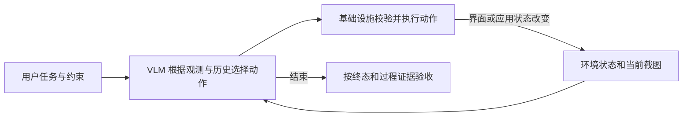

# 4a · Computer Use Agents：课程笔记

课件：[lecture-07-computer-use-agents.pdf](lecture-07-computer-use-agents.pdf)。以下使用本地 PDF 的实际页序，部分页面印刷页码不同。数字来自课件，“补充理解”用于解释机制和工程含义。

## CUA 如何通过屏幕操作软件（第 1–8 页）

**Computer Use Agent（CUA）**通过渲染后的界面观察软件，以点击、键入、滚动或手势改变环境，再查看变化。浏览器可跨页面购物，桌面可跨应用处理文件，移动设备可操作不同界面和手势。

课件的蓝杯演示把过程分成几轮：在商品列表点击蓝杯，打开详情页后向下滚动，找到邮编输入框并点击，再输入 15213 查询配送。动作的目标随页面状态变化，上一轮的点击位置直接复用到下一张图上可能点中别的控件。训练或基准可以在任务结束时根据环境给出奖励。买杯演示与后续评测中的“只加购、不购买”是两种任务规格，停止条件要读当前指令。

**补充理解**：界面只展示环境状态的一部分。输入框出现文字能说明键入生效，订单是否创建还需看确认页或订单状态。基础设施校验动作格式也只说明动作可以执行，业务上是否应执行还取决于任务授权和约束。

## 从玩具网页到真实软件工作流（第 9–15 页）

| 环境阶段 | 课件例子 | 增加的难度 |
| --- | --- | --- |
| 简化网页 | MiniWoB、MiniWoB++、WebShop | 在受控界面学习基本操作。WebShop 加入真实商品和自然语言购物目标 |
| 更真实的网页与桌面 | WebArena、VisualWebArena、OSWorld | 需要理解多页网站、视觉目标、桌面应用和系统状态 |
| 带历史数据的跨应用环境 | MyPCBench、CUA-World | Mail、Calendar 和项目记录共享身份背景，专业软件带有工作数据和实际任务 |
| 长真实用例 | OSWorld 2.0 的 SolveSpace 演示 | 需要遵循参考视频和尺寸，完成多步骤建模并保存。课件也指出耗时和费用仍是问题 |

## 评估目标：动作、结果与过程（第 16–19、25、29、33、39 页）

统一示例是“把售价低于 20 美元的蓝杯放进购物车，禁止购买”。同一条执行轨迹可以有不同的成绩：

| 评估目标 | 证据 | 示例 |
| --- | --- | --- |
| 单步动作 | 固定截图、目标框或参考动作 | 点击点落在蓝杯的目标框内，或匹配元素、操作和输入值 |
| 任务结果 | 应用、数据库、文件状态或可见证据 | 购物车有正确商品，金额低于 20 美元 |
| 过程约束 | 动作轨迹、订单状态或审计证据 | 从未发起禁止的结账动作 |

**程序化验证**可以直接检查购物车、价格及订单数。条件明确时易复跑，覆盖面取决于写进验证器的规则。课件特意给出一条缺漏：WebArena 的建仓示例要求创建空仓库，简化验证器只访问目标 URL 并核对名称，未检查仓库是否为空。

**LLM / VLM 裁判**根据截图、轨迹和 rubric 给出判定，可表达较难编程的标准。截图有限时，证据只能覆盖其中可见的部分，例如“最后几张图没显示下单”。**人工复核**可以直接打分，也可审计自动裁判并裁决分歧。蓝杯示例中，订单确认记录一旦出现，即使商品和价格正确也应判失败。

**补充理解**：先确定任务关心什么，再选证据。若要检测被撤销的越权操作，单看最终购物车可能漏掉它，需要查轨迹或事件记录。

## 静态评估：固定观测上的 grounding 与动作匹配（第 19–23、86–88 页）

**Grounding（定位）**把语言中的目标映射到屏幕里的位置。ScreenSpot-Pro 覆盖 1,581 张截图、23 个应用和 3 个操作系统。Blender 例子要求构造 UV sphere，单步评分用原图像素中的目标框 (417, 132)–(576, 152)，原图为 2560 × 1440。若输入截图有缩放，要把预测坐标换回评分所用的坐标系。

**离线动作匹配**还要核对操作和输入值。Mind2Web 覆盖 2,350 个任务、137 个网站、31 个领域。租车例子的记录步是点击 CAR 标签，比较目标元素和 CLICK 操作，无需实际跑完租车流程。与参考动作不同但有效的路径，需要在能执行后续步骤的评估里确认。

补充基准包括 Android in the Wild（715K episodes、约 5.69M examples），AndroidControl（15,283 条演示、833 个应用，提供高层目标和低层指令），以及 AgentNetBench（100 个桌面任务，离线逐步匹配）。这些数据规模说明覆盖面，计量单位分别是 episode、动作样本、演示或任务。

## 端到端评估：网站和桌面状态（第 24–37、89–92 页）

| 基准 | 课件规模 | 执行与验收 |
| --- | --- | --- |
| WebArena | 812 个任务、4 个自托管领域 | 在可复现的网站里运行，按环境终态检查 |
| VisualWebArena | 910 个任务、3 个自托管网站，25.2% 任务带图片输入 | 视觉信息可成为完成任务所需条件，再检查结果 |
| WebVoyager | 643 个任务、15 个在线网站 | 用任务、最终回答及最近若干截图进行 VLM 判定，报告与人工一致率 85.3% |
| Online-Mind2Web | 300 个任务、136 个在线网站 | 人工与 WebJudge 结合，课件报告一致率 85.7% |
| OSWorld | 369 个任务、9 个应用 | 每题有初始化逻辑，按应用状态或输出文件检查 |
| WindowsAgentArena | 154 个任务、11 个程序 | 在并行 Windows VM 中跑程序化终态检查，课件给出约 20 分钟的并行评估 |

WebVoyager 的 GitHub 搜索例子用历史截图与回答作为证据。现实网站的内容、页面布局和账户状态会变化，因此跨轮比较时要考虑环境漂移。两组裁判一致率来自各自基准，含义是与人工标签的一致程度。

**OSWorld 记账例子**：读取收据，在给定工作簿添加开支。验证器对比保存文件和参考文件，检查 A1:E8 维持原值、C9:C13 的标签以及金额和余额。验证同时覆盖请求的新增结果和原有数据。

WorkArena 和 WorkArena++ 分别展示参数化 ServiceNow 任务及组合型企业流程。AndroidWorld 基于系统状态奖励，在 20 个应用中提供 116 类参数化任务。MobileWorld 含 201 个任务，约 62.2% 跨应用，使用程序化或混合验证，另涉及澄清和结构化工具。

## 长程评估：分项进展、产物质量和约束（第 38–45、93–94 页）

| 基准 | 课件规模 | 主要检查 |
| --- | --- | --- |
| Odysseys | 200 个在线任务，平均 6.1 项 rubric，主要设定上限为 100 步 | 按整个流程的证据给分项成绩 |
| OSWorld 2.0 | 108 个工作流，人类中位耗时 1.6 小时，Agent 平均 318 次调用 | 对跨应用或专业产物做部分和二元验收 |
| CUA-World-Long | 200 个长任务，常需超过 500 步 | 每款软件一个长任务，VLM 用清单按质量标准检查 |
| MyPCBench | 184 个任务、17 个已登录应用，68% 跨应用 | 在带共享身份和历史的环境中逐项评分 |
| WeaveBench | 114 个任务，中位 16 次切换与 76 次工具调用 | 评估 GUI 与 CLI 混合轨迹，检查过程是否走了不合规的捷径 |

**Odysseys 婚礼行程**：比对 PIT–LAX 和 PIT–PSP 航班，检查 9:00–16:00 驾车时间窗，推荐机场，打开带价格的租车选项，检查两处餐厅绕路，制作可编辑日程并给总览。示例只漏了餐厅绕路，分项成绩为 7/8 = 0.875，完全完成指标为 0。分项分数可用来定位剩余工作。

**OSWorld 2.0 支架建模**：要求按工程图制作 FreeCAD 支架并导出 STEP。课件展示实际已导出文件但模型不符合参考图的失败案例。验收应检查关键几何或尺寸。相邻的 SolveSpace 演示是根据视频复现机械零件的另一个任务。

## VLM 如何用视觉历史预测动作（第 46–57 页）

每轮输入包含目标、截至当前的截图、此前已执行的动作。第 t 次动作可写为 πθ(aₜ | goal, o≤ₜ, a<ₜ)。教学生成顺序如下：

1. 模型读目标和截图 0，输出点击商品的动作 0。
2. 基础设施执行，记录动作 0 并提供截图 1。此时模型能看见商品详情页。
3. 模型根据交错历史继续点击加购或做其他操作。进入购物车后可检查结果，并在满足当前任务的停止条件时结束。

文本由 tokenizer 处理成词元再嵌入，截图经视觉编码器和投影层转成一组向量，二者交错输入因果 Transformer。这里的视觉 token 是连续表示，截图尺寸与编码方式影响实际长度。**补充理解**：这接续 2a 的上下文管理问题。只读当前图可能忘记以往已完成什么，保留过多旧图会增加预算，应保留对进度和约束有用的观察。

动作接口有脚本、原生电脑工具调用和应用定义的函数调用，有的传原图像素，有的传 0–999 的归一化坐标。第 57 页是课件当时的接口示意。做比较时，应把坐标换算、缩放、等待和一次返回多个动作的规则也纳入记录。

## 训练分工：定位、模仿与环境奖励（第 58–65 页）

| 阶段 | 数据 | 学习信号 |
| --- | --- | --- |
| 预训练 | UI 截图、元素框、标签、OCR、点击和手势 | 学屏幕上是什么，以及如何指向和操作 |
| SFT | 目标与人类演示，或经筛选的 Agent 轨迹 | 根据当前观测和历史预测演示中的下一步 |
| RL | 在可重置环境里自行执行，按任务验证器评分 | 探索多种路径，根据轨迹结果调整策略 |

MolmoWebMix 有 36K 人类和 105K 合成任务轨迹，课件合成示例用能读 accessibility tree 的教师执行再筛选。AgentNet 发布 22,625 条桌面轨迹，覆盖 3 个操作系统。对比数据量时，应留意有的统计交互次数，有的统计整条任务轨迹，以及轨迹是否跨应用。

蓝杯例子中，SFT 可以模仿点击商品、加购、验证停止。RL 让策略自行选择动作，然后根据正确商品、数量、价格和未结账等条件评估。课件以预约机场用车解释为什么训练要可重置：重复试错可能创建多笔付费预约、叫来司机，取消也未必恢复时间或费用。

## 构建训练环境：CUA-Gym 与 Gym-Anything（第 66–74 页）

**CUA-Gym** 建造可重用的仿真应用。规划 Agent 从参考软件提炼需求，开发 Agent 实现，网页 Agent 操作验证。应用支持注入初始状态、读取终态和重置会话。任务、初始状态与奖励构成训练元组。环境和奖励验证逻辑分别生成，再用预期失败与成功的状态检查二者是否一致。课件记录 94 个模拟网页应用和 16 个桌面应用，合计 110 个环境、32,112 个已验证元组，其中 38% 涉及跨应用。

**Gym-Anything** 在真实安装的软件上准备任务环境。创建 Agent 装配软件和数据，独立审查 Agent 核实环境。先实际执行种子任务，再用模型扩充并过滤。评估使用截图等证据、评测侧可见的额外信息和加权检查表，允许给部分分并做完整性检查。课件统计覆盖 200 款软件、Linux / Windows / Android 三个平台、12,103 个任务与环境。

| 课件实验 | 方法与设置 | 结果 |
| --- | --- | --- |
| CUA-Gym | 3,578 条 SFT 演示，再对 10,858 个已验证元组做 GSPO。OSWorld-Verified，GUI 调用，100 个模型步骤，程序化验收 | 课件报告 62.2% → 72.6% |
| Gym-Anything | Kimi-K2.5 教师提供约 2,000 条成功轨迹，SFT Qwen3-VL-2B-Thinking。CUA-World-Test，200 步，Gemini 3 Flash 清单裁判 | 平均清单分 12.7 → 22.5（满分 100），完全通过率 1.6% → 4.4% |

第 69 页同时放了数据规模消融曲线与主结果，曲线使用各自的数据子集和训练步数。第 73 页分别改变软件覆盖或任务数据比例，两条曲线都随完整数据训练获得更高分。两张图的基准、预算和验收方式不同。

## 部署问题：成本、个人上下文与协调（第 75–85 页）

- **速度与成本**：截图和推理同时占用上下文与生成预算。若用“轮数 × 每轮平均时间”近似任务时间，可从减少轮数和缩短每轮着手。Game-TARS 在关键决策才显式推理，常规步骤直接行动。课件以 FDM-1 介绍高频直接动作预测，批处理和更好的规划也可能缩短任务时间。
- **个性化**：用户偏好、文件和应用历史会变化。课件的 GUM 从活动中检索并更新带置信度的用户事实，MyPCBench 用跨应用历史考查代理是否能据此完成任务。保留用户对记忆的同意、更正和删除能力。
- **基础设施与交互**：隔离的后台会话可减少对用户当前操作的干扰。进度需要可见，用户能纠正、审批或中断。第 79 页展示了 Codex 后台电脑操作的课件演示。
- **多 Agent**：回到 3a 的 MACU，依赖满足的节点派给隔离环境中的不同 CUA。交接文件和证据后统一核验，再据失败调整计划。混用 CUA、代码与结构化工具时，要处理操作冲突和协调开销。

第 82–85 页是基准、训练、系统和产品的分类参考。第 86–94 页为部分基准的补充卡片，已按评估方式归入前面的复习内容。

## 复习：用蓝杯任务串起整节课

1. 给定截图，能否定位蓝杯并选对动作？用固定观测的 grounding 或动作匹配检查。
2. 执行结束后，购物车数量、价格与订单状态是否符合要求？用终态规则检查。
3. 如果期间结账后又取消，是否会被终态漏掉？用轨迹或订单事件核查过程。
4. 如何训练策略找到可行路径？用演示学习基础动作，在可重置环境中用可信验证器给结果奖励。
