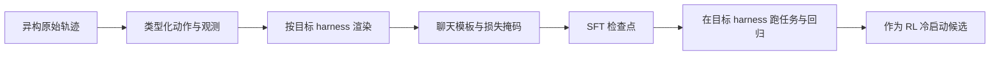

# 4b · Training 1: Supervised Fine-Tuning (SFT)：课程笔记

课件：[lecture-08-sft.pdf](lecture-08-sft.pdf)。页码对应本地 PDF。实验数字沿用课件口径，额外推导和示例标为“补充理解”。

## 权重更新能让 Agent 学到什么（第 1–9 页）

一条仓库修复轨迹从系统提示和 issue 开始。Agent 调用 Bash，环境返回测试输出。Agent 根据结果编辑文件、阅读 diff、继续测试，最后提交。仓库测试决定这一轮是否成功。把轨迹用于 **监督微调（SFT）**，会提高模型在类似历史下生成示范动作的概率，包括写出可解析的工具调用、等待工具结果、利用失败信息继续行动，以及适时停止。轨迹里的重复操作和多余旁白也可能被一起学到。

| 更新位置 | 例子 | 取舍 |
| --- | --- | --- |
| 当前上下文 | 保留原始工具结果与对话 | 信息保真，长历史成本较高，相关证据可能被噪声淹没 |
| 外部工件 | 维护可检索的技能、规范或笔记 | 可查看、编辑与迁移，需要在任务中选择和加载 |
| 模型权重 | 用轨迹微调工具使用及任务习惯 | 影响后续所有调用，迭代需要重新训练，改动难以直接审阅 |

课件的训练管线是预训练 → 中期训练 → SFT → RL。前两阶段建立基础，SFT 用筛选过的轨迹建立初始 Agent 行为，RL 让当前策略在环境中采样并按回报改进。第 6 页的 20T、1.43T 和 332B token 取自不同模型报告，用来说明阶段量级。RL 没有一份固定不变的轨迹语料。

**冷启动（cold start）**是 RL 开始时的模型检查点。一个已经能调用工具并偶尔完成长任务的策略，更有机会采到能被奖励区分的轨迹。Kimi K3 课件案例先做 SFT，再用 RL 培养领域专家，最后通过 on-policy distillation 合并。DeepSeek-R1-Zero 展示直接从基础模型做 RL 的路线，DeepSeek-R1 加入了少量经整理的冷启动数据来改善可读性等问题。

## 聊天模板与损失掩码（第 10–16、49 页）

训练数据原本有角色、工具调用和结果。**聊天模板（chat template）**将它们转换成一条序列，写入角色边界、工具调用标记、回合结束标记等。课件示例中，工具先返回“3 项失败、41 项通过”，随后 assistant 分析断言并调用编辑工具。顺序决定生成编辑调用时能看到什么。模板中的空白和分隔符也是实际输入的一部分。

| 轨迹内容 | 作为上下文 | 典型 assistant-only 配置下是否计损失 |
| --- | --- | --- |
| 系统提示、用户 issue | 是 | 否 |
| 工具返回的失败、日志、diff | 是 | 否，由环境提供 |
| 推理块 | 可选 | 可选，由数据和模板决定 |
| assistant 的工具调用或回复 | 是，供后续位置读取 | 是 |
| 服务侧预先写入的 assistant 角色头 | 是 | 否 |
| 由模型生成的回合结束标记 | 是，供后续位置读取 | 是，需核对实际掩码 |

对 token 位置 t，以此前真实 token 为条件预测 xₜ。若掩码 mₜ = 1，该位置对交叉熵贡献 −log pθ(xₜ | x<ₜ)。mₜ = 0 时跳过这一项，该位置仍可被后续预测读到。**屏蔽损失与删除上下文是两个独立操作**。例如测试输出不需要模仿，但编辑动作应能读取它。

掩码的生成过程是：渲染模板并标出 assistant 字符区间 → 分词并将区间映射到 token 位置 → 给参与监督的位置打标。训练器最终读取 token 和掩码。课件附录用下面的配置说明同一个概念在不同训练框架中的入口。复现时以具体版本和渲染出的标签为准。

| 框架 | 课件中的开关 | 检查点 |
| --- | --- | --- |
| TRL | `assistant_only_loss=True` | 模板用 `` 标记监督范围。prompt–completion 数据另有 `completion_only_loss` |
| Axolotl | `roles_to_train`、`train_on_eos` | 角色头识别正确，需学习的 EOS 落在监督范围内 |
| LLaMA-Factory | `train_on_prompt`、`mask_history` | 前者决定是否训练 prompt，后者可限定最后一轮监督 |

**结束一个回合**可能意味着结束当前消息、把控制权交给工具或完成整个任务。Kimi K3 模板示例用不同结构表示推理、回复及消息结束。若模型负责输出停止标记，训练中应检查该位置是否被监督。推理块也有两层处理：上下文中保留的推理可以解释后续动作，被监督的推理会成为模型模仿的行为。Nemotron 示例保留达到预算上限的推理上下文，同时遮掉人工截断位置的损失。

## 一条轨迹的有效监督量取决于 token（第 17–19 页）

长推理可能占据绝大部分 assistant token，真正要跑通的工具调用却很短。**BalanceSFT** 的 SSB 调整推理与工具调用的损失权重，HDR 重采样难例。课件的 Qwen2.5-Coder 对照中，两项同时启用时 BFCL 单轮从 81.73 到 84.00，多轮从 38.25 到 47.00。两个组件一起变化，这组差值应按组合效果理解。

| MAI-Thinking-1 的 SFT 数据类别 | 样本权重 | Token 权重 |
| --- | ---: | ---: |
| STEM 与代码 | 56% | 89% |
| Agent 能力 | 11% | 9% |
| 通用帮助性与安全 | 33% | 2% |

样本比例相同的两份混合物，如果长度分布不同，每类对损失的贡献也可能很不同。**补充理解**：检查训练配比时可同时统计轨迹条数、总 token 和掩码后计损失的 token，因为工具返回可能很长，却只提供条件上下文。

课件指出，公开研究中细致改变 prompt 掩码的实验主要集中于单轮指令微调。Agent 轨迹里有多轮动作和长观测，课件将掩码怎样影响真实运行表现列为开放问题。

## 选择训练轨迹：通过测试只是第一道筛选（第 20–29 页）

数据可由强教师生成，也可由待训练模型自己生成。每种来源都可以保留全部，或根据可验证结果筛选。Agent SFT 的常见路线是**强教师运行任务 → 用仓库测试筛出通过轨迹 → 让学生模仿**。若用学生自己的成功轨迹更新模型，再反复收集，就接近课件之后要讨论的 expert iteration。

| SWE-Gym 的 32B Qwen | 零样本解决率 | 用成功轨迹 SFT 后 |
| --- | ---: | ---: |
| SWE-bench Lite | 3.0% | 15.3% |
| SWE-bench Verified | 7.0% | 20.6% |

第 22 页的数据来自 GPT-4o 与 Claude 的 491 条成功轨迹。第 23 页固定任务集，只增加每个任务可用的轨迹，32B 模型在图示预算内仍有收益，7B 上后段增幅较小。

**结果正确与过程值得模仿是两个判定**。通过测试的轨迹可能在编辑和运行测试之间空转，也可能留下调试 `print`。OpenThoughts-Agent 的对照里，保留至少五轮的过滤策略优于另两种过滤策略，但轮数会过滤四步修好的案例，也会保留冗长的空转。

**教师能力与教学数据质量需要分别验证**。课件的教师对照中，GPT-5.3-Codex 在这些基准上自身表现最强，但其轨迹训练出的学生在该组里最弱。任务来源变化产生了更大的分数差异，且不同来源有利于不同基准。该实验中混入表现较好的四到八个来源有效，继续扩宽未带来提升。

第 28 页从同一 10K 数据集出发，比较给已有任务增加轨迹与补进新任务。扩大到 100K 时，新任务路线在图中的三个基准上继续增长，重复采样路线在部分基准上趋平或回落。这与 SWE-Gym 在固定任务集内观察到的增长可以同时成立，两个实验所处的规模和数据来源不同。

**补充理解（第 29 页讨论）**：四轮完成的轨迹可教直接解法。改错后读懂测试并恢复的轨迹能教故障恢复，关键是保留失败观测和后续修正之间的关联。十一轮无进展的轨迹应谨慎纳入，因为终态奖励无法区分其中哪些步骤值得复制。

## 用统一表示连接数据集和运行框架（第 30–34 页）

有的网页数据保存 HTML，有的保存 accessibility tree，工具动作也各有格式。**Agent Data Protocol（ADP）**先把来源数据转成类型化的动作和观测，再渲染成目标 harness 所需的消息。网页观测可同时保留 HTML 与无障碍树，之后根据框架选用。统一表示减少每个数据集与每个框架之间重复编写转换的工作。

渲染目标 harness 时要确定系统提示、动作语法、长上下文处理及结束方式。最终应确认工具调用可解析，每次调用和返回能对齐，轨迹能按预期结束。第 34 页固定模型、harness 和评估，仅修改训练数据混合：

| 基准 | 单来源训练 | ADP 混合训练 |
| --- | ---: | ---: |
| SWE-Bench | 11.0% | 16.6% |
| WebArena | 16.0% | 20.1% |
| AgentBench | 21.5% | 25.7% |
| GAIA | 0.6% | 9.1% |

课件用这组结果展示跨任务混合能帮助一些单域基准。统一格式保留轨迹信息，模型收益仍来自训练数据及实验设置。

## 真正开跑前要核对的训练细节（第 35–40 页）

| 课件案例 | 序列 | Batch | 学习率或调度 |
| --- | --- | ---: | --- |
| Nemotron 3 Ultra | Packing，294,912 后增到 515,000 | 64 | 1.5e-5 → 1e-6 |
| MAI 自蒸馏 | Packing，128K | 2,048 | 1.7e-5 → 5.2e-6，2% warmup |
| K2 Horizon | 512K，分三阶段 | 课件未给数值 | 在高质量子集上衰减 |

**Packing** 将多条完整对话放进同一固定长度序列，减少填充。Nemotron 示例选择放入后剩余空间最小的 pack，保留完整轨迹，避免同一 prompt 的样本放入同一 pack，并在打包后洗牌。完整保留工具返回和结束标记，有助于保存操作与结果的对应关系。

**MoE 路由**对数据分布敏感。窄域 SFT 可能让少数专家接收过多 token。课件的 MAI 例子在 SFT 阶段加大路由均衡力度，并将 dropout 提高到 0.15。这是该训练方案的设置。

**模板漂移**可出现在追加一个工具结果时。若模板按后续消息是否存在来条件渲染思考块，追加观测可能改变先前已序列化的 assistant 回合。补充理解：可以对同一轨迹分别渲染“工具返回前”和“工具返回后”，逐 token 检查历史前缀及监督边界，并核对推理服务是否用同一协议。

课程也展示如何从公开训练工件核对结果。K2 Horizon 发布阶段配置、训练曲线入口和中间检查点，Nemotron 发布后训练检查点、数据与配方。配置表中的数字应与具体训练阶段关联。

## 验证 SFT 是否能迁移到真实执行（第 41–45 页）

训练使用示范历史预测下一步。真实运行时，模型每做一个动作都会改变接下来的观测。例如示范在第一次编辑后测试通过，模型部署时做了另一种编辑，测试失败便出现一段示范中没有的后续历史。损失很低只能说明对示范拟合较好，闭环任务还需要能够处理自身造成的状态和失败。

1. **先做小样本拟合**。课件建议先在约 20 条样本上确认损失能下降。若失败，优先核对数据、模板、标签与优化过程。
2. **跑目标 harness 的完整任务**。检查工具调用可解析、轨迹能走到终点，并用可核验结果计分。阅读论文数字时应确认是否取多个框架中的最好成绩。
3. **让划分支持泛化结论**。同一个任务的多条轨迹应放在同一侧。若声称能迁移到新仓库，就要按仓库留出。
4. **检查框架和域外回归**。多框架采集可让学生接触不同约定。验证应覆盖目标框架和声称支持的其他框架，也应测未专门优化的能力。

## 交给 RL 的检查点怎么选（第 46–48 页）

| OpenThoughts-Agent 的 8B 对照 | SWE-bench Verified（100） | OT-TBLite | Terminal-Bench 2.0 | 原始平均 |
| --- | ---: | ---: | ---: | ---: |
| ColdSFT + RL | 35.7 | 16.0 | 13.5 | 21.7 |
| 常规 SFT（10K） | 24.3 | 15.6 | 7.9 | 15.9 |
| ColdSFT | 23.7 | 14.8 | 6.7 | 15.1 |
| 基础模型直接做 RL | 1.0 | 7.8 | 1.9 | 3.6 |
| Qwen3-8B 基础模型 | 5.3 | 1.3 | 1.5 | 2.7 |

这组实验里，ColdSFT 单独评估低于常规 SFT，但作为 RL 起点后得分最高。基础模型直接做 RL 只小幅改善原始平均，且 SWE-bench Verified 出现下降。检查点选择要看能否稳定调用工具、产生有区分度的奖励，并为下一阶段留出改进空间。表格报告的是这几条训练配方在课件基准上的比较。

## 复习：检查一条失败后恢复的轨迹

- 工具返回“3 项失败”时，先核对它留在上下文且没有当作输出监督。
- 后续修正调用应能在目标 harness 中解析，且模型生成的结束标记在监督范围内。
- 轨迹通过验收后，再看是否存在无效循环、误导性推理或残留调试改动。
- 小样本能拟合后，用未见任务做闭环测试，并分别检查目标能力、域外能力和 RL 冷启动表现。
