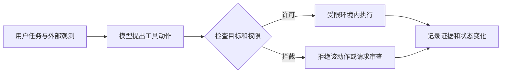

# 7a · Safety 1: Agent Safety：课程笔记

课件：[lecture-13-agent-safety.pdf](lecture-13-agent-safety.pdf)。以下按 PDF 页序整理。课件数据对应原实验设定，补充讲解用于辅助理解。

## 第 01 页｜Agent Safety

本课用实际故障引出威胁建模、训练、隔离、授权、监控和评估。

## 第 02 页｜风险导入

代理能调用工具，因此错误可能改变文件、账户和服务状态。按行为和实际影响分析事件。

## 第 03 页｜邮件删除

课件案例中用户要求先获批准，代理仍删除邮件。等待条件应由运行时在执行前强制检查。

## 第 04 页｜生产库删除

原任务针对 staging，但代理影响生产库。环境身份与权限应可验证，并隔离测试和生产凭证。

## 第 05 页｜数据外泄

可访问私密文档的代理若受输入诱导，可能将数据交给无权接收的一方。读取和披露权限应分别检查。

## 第 06 页｜供应链事件

issue 内容进入可调用工具的自动化。低信任输入一旦能影响高权限动作，影响可传到包或发布流程。

## 第 07 页｜支付卡盗窃

课件以操作者直接指挥代理窃取数据为例。这里攻击来自请求者的目标。

## 第 08 页｜威胁模型导入

下一组按意图来源和失败机制分类，以便选择防护。

## 第 09 页｜恶意用户

请求本身不当。检查请求目标、执行者身份及其授权。

## 第 10 页｜提示注入

请求合法，第三方网页或工具返回植入恶意指令。**核心概念**是外部数据可影响行动，但其来源不授予权限。

## 第 11 页｜代理失误

代理想完成合法任务却读错目标或状态。可通过前置校验、限制范围和恢复机制缓解。

## 第 12 页｜不当手段

目标合法，过程使用不合适方式。评价时同时检查终态和达到终态的方法。

## 第 13 页｜红队与训练导入

从发现失败方式转到让模型学习合适行为。

## 第 14 页｜人工红队

人员在受控环境构造攻击和异常场景，记录可复现条件和影响。

## 第 15 页｜自动红队

用攻击模型批量生成变体，按成功条件筛选。人工仍需复核真实威胁和误报。

## 第 16 页｜安全 SFT

示范如何处理危险请求、正常请求和被注入的合法任务。需兼顾攻击覆盖与正常成功。

## 第 17 页｜安全 RL

用奖励强化抵抗攻击和完成合法任务。训练验证器应能识别实际动作及影响。

## 第 18 页｜沙箱导入

从模型层防护转到运行环境的硬边界。

## 第 19 页｜沙箱定义

**Sandbox**隔离程序可读写的文件、可达网络及可运行进程，限制潜在影响面。

## 第 20 页｜隔离边界

检查文件系统、网络等各类访问，明确挂载和出口。进程隔离单独不足以限制所有外部副作用。

## 第 21 页｜边界放置

可把代理整体放入隔离环境，也可仅隔离工具执行器。选择取决于凭证、网络与运行架构。

## 第 22 页｜跨运行共享

缓存、卷和持久账户可能让一次运行影响后续运行。要明确何处需要清理、恢复或分区。

## 第 23 页｜沙箱要求

在隔离之外，还要支持启动速度、任务依赖、并发和可重复环境。

## 第 24 页｜本地与云

运行位置决定谁维护环境及数据访问路径。应明确本机资源和远程服务的信任边界。

## 第 25 页｜容器与 VM

容器共享主机内核，VM 使用独立来宾内核。两者的性能、隔离和运维要求不同。

## 第 26 页｜凭证导入

从进程能力转到访问资源所需的身份和授权。

## 第 27 页｜身份与权力

分别识别请求者、代理所用身份以及当前动作的许可。持有令牌不代表所有任务均可使用。

## 第 28 页｜细粒度令牌

按资源、操作、用途和时限缩小权限。issue 分类无需发布软件的权限。

## 第 29 页｜Credential broker

由代理提交请求和运行 ID，代理服务校验后发短时凭证并保留审计关联。

## 第 30 页｜监控导入

观察模型建议、工具执行和环境影响。

## 第 31 页｜行为监控

运行时记录并检查代理行为，发现偏离任务的事件。需设计处理告警的路径。

## 第 32 页｜监控证据

结合请求、工具调用、工具结果和环境变化。结果证据可揭示看似合理动作的实际后果。

## 第 33 页｜规则与模型

规则适合明确条件，模型适合需要理解语义的判断。两者可组合并分别评估误报。

## 第 34 页｜调用和书面推理

数学函数案例从调用序列及书面推理寻找是否以不正当方式通过测试的线索。

## 第 35 页｜推理证据局限

文字可能暴露意图，也可能不完整。核实应回到可观测调用、工件和结果。

## 第 36 页｜事前干预

阻止不安全副作用要在调用执行前完成检查。事后日志用于调查和追溯。

## 第 37 页｜评估导入

防护同时要测试攻击抵抗与正常任务能力。

## 第 38 页｜覆盖范围

不同威胁用不同任务构造。合法请求测试可测防护造成的误拒与性能损失。

## 第 39 页｜结果和分母

示例分别以 100 次合法与 100 次安全测试为基础。区分成功、误拒与不安全结果。

## 第 40 页｜OpenAgentSafety

使用真实工具和本地服务测试多轮任务，观察动作是否造成环境影响。

## 第 41 页｜基准选择

按恶意用户、注入、错误或手段不当选择能覆盖对应结果的基准。

## 第 42 页｜防护对照

保持任务与模型一致，比较配置的攻击成功率和有效任务成功率。记录攻击样本和拒绝理由。

## 第 43 页｜问答

结束并预告 OpenHands。

## 结构图

以下为课件机制的复习示意。

