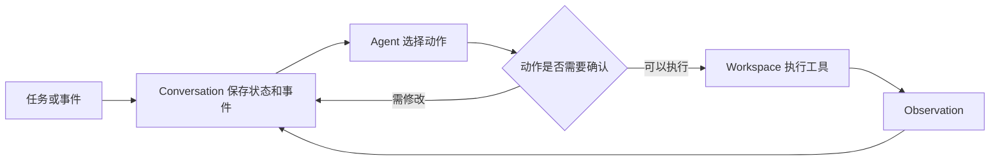

# 7b · Frameworks 1: OpenHands：课程笔记

课件：[lecture-14-openhands.pdf](lecture-14-openhands.pdf)。以下按 PDF 页序整理。课件数据对应原实验设定，补充讲解用于辅助理解。

## 第 01 页｜OpenHands

课件从早期代码代理讲到 SDK、托管方式和软件自动化。

## 第 02 页｜前端演示

用简单前端任务引出代理如何操作工作区并交付能运行的结果。

## 第 03 页｜Agent Canvas

课件列出 Canvas 演示，用图形界面组织任务、运行状态及审查入口。

## 第 04 页｜历史导入

过渡到代码补全、仓库评测和通用代理的发展。

## 第 05 页｜代码补全

早期 Copilot 和 Cursor 提供编辑位置附近的建议。HumanEval 主要测单函数生成。

## 第 06 页｜仓库级评估

SWE-bench 将真实 issue、仓库快照、补丁及测试结合，任务跨文件和依赖。

## 第 07 页｜Devin

课件用产品演示说明早期软件工程代理开始整合多步任务和工具。

## 第 08 页｜OpenDevin

早期系统把前端、代理和 Docker 执行环境组合起来。界面、决策和执行可分别演化。

## 第 09 页｜早期代码代理

SWE-agent 等把文件搜索、修改与验证接入代理循环，工具接口成为系统能力的一部分。

## 第 10 页｜基准进展

课件将改进归因于更强的模型与更好的工具和系统。比较时应固定其中一方。

## 第 11 页｜部署需求

长运行、暂停恢复、并行、进度展示和结果检查成为实际使用的组成部分。

## 第 12 页｜SDK 导入

转入可复用的代理、会话、工具和工作区抽象。

## 第 13 页｜默认可用与可扩展

SDK 提供模型、工具、状态和工作区的默认组合，也允许替换组件。

## 第 14 页｜模型和工具

Agent 保存模型和工具配置，例如终端、编辑器、任务记录。相同配置可供多个任务复用。

## 第 15 页｜Conversation 与 Workspace

**Conversation** 管目标、动作、观测与运行状态，**Workspace** 管文件和执行环境。一次运行持续动作和观测循环。

## 第 16 页｜自定义工具

类型化 Action 描述输入，Executor 实现行为，Observation 给模型可读结果。

## 第 17 页｜持久化

保存会话事件与状态，用同一 ID 和存储恢复。恢复时也要保证关联工作区可用。

## 第 18 页｜上下文压缩

将旧事件总结，保留初始指令和近期工作。摘要可减开销，也可能丢失关键细节。

## 第 19 页｜远程执行

Docker 内运行 Agent Server，调用方通过会话 API 传任务、接收事件。运行地决定文件与进程边界。

## 第 20 页｜动作确认

敏感动作在执行前暂停等待决定。若拒绝，模型可以根据反馈修订动作。

## 第 21 页｜单代理与多代理导入

过渡到任务拆分和协调成本。

## 第 22 页｜专门角色

早期系统分配 Manager、复现者等角色，显式交接计划和证据。

## 第 23 页｜单代理基线

同一代理复现、定位、编辑、测试，关键上下文可在这些步骤间直接共享。

## 第 24 页｜通用工具

少量编辑、终端等原语可组合处理代码、配置、文档。任务规则可补充使用方式。

## 第 25 页｜Skills

通过可加载说明添加项目约定与重复流程，让同一代理完成多种工作。

## 第 26 页｜MCP

服务器提供工具描述与执行能力。代理选择工具时需要理解权限和参数契约。

## 第 27 页｜通用任务

OpenHands-Versa 组合代码、视觉浏览、搜索和文件访问，允许同一任务跨界面操作。

## 第 28 页｜何时分工

独立 issue、仓库或复核适合并行。需要同步修改同一文件时，先设计隔离和合并。

## 第 29 页｜托管和界面导入

转入本地或云端执行，以及不同交互入口。

## 第 30 页｜本地与云端

本地便于复用已有文件和服务，云端可减少对本机持续在线的依赖。数据和权限边界随地点变化。

## 第 31 页｜执行地点与入口

IDE、GUI、CLI 和集成可以搭配本地或云端执行。使用界面与运行位置是两个维度。

## 第 32 页｜IDE

在熟悉的代码界面查看文件、diff 和测试，适合日常编辑与审查。

## 第 33 页｜专用 GUI

围绕任务组织并行运行、预览和补丁，便于检查长时间执行结果。

## 第 34 页｜人工投入研究

课件对 20 名常用 Copilot 的用户执行 Python 任务进行比较。应区分主动操作时间、监督和最终质量。

## 第 35 页｜CLI

在本地或远端终端操作，适合脚本和自动化。交付证据仍应清楚可审查。

## 第 36 页｜工作渠道集成

从 issue 取上下文，在 PR 展示差异、测试和审查。执行身份和权限应与事件绑定。

## 第 37 页｜自动化导入

过渡到事件触发的软件开发任务。

## 第 38 页｜自动化仪表板

课件展示可查看自动化配置与运行记录的界面，用于找触发来源和结果。

## 第 39 页｜一次自动化运行

issue、PR 或日程触发明确任务，限定仓库和权限，生成可检查的结果。

## 第 40 页｜自动化演示

课件示范 issue 分诊或 PR 审查记录，关注触发、指令、权限和结果如何串起来。

## 第 41 页｜Software factory

把分诊、需求、实现、验收和审查作为可重复交接。每一步应说明输入工件与完成条件。

## 第 42 页｜SkillRefiner

依据历史运行发现失败模式并改写技能。将新版本放到留出任务验证。

## 第 43 页｜技能改进结果

课件报告留出任务准确率和 PR 审查 F1 有改善。评价应观察是否引入新的误报。

## 第 44 页｜问答

结束并预告 LangGraph。

## 结构图

以下为课件机制的复习示意。

