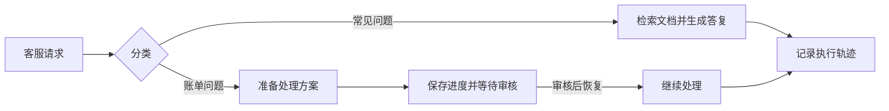

# 9a · Frameworks 2: Orchestration and Monitoring：课程笔记

课件：[lecture-15-orchestration-and-monitoring.pdf](lecture-15-orchestration-and-monitoring.pdf)。以下按 PDF 页序整理。课件数据对应原实验设定，补充讲解用于辅助理解。

## 第 01 页｜编排与监控

本课连接显式工作流、持久化和跨运行行为分析。

## 第 02 页｜动作周围的结构

技能、计划和工作流都可约束代理，区别在约束如何表达和何时确定。

## 第 03 页｜代理与工作流

单代理自由选择下一步，工作流将部分转移交给程序。两者都可调用模型和工具。

## 第 04 页｜固定流程的收益

已知过程可减少模型决策，提高一致性、性能和可测试性。

## 第 05 页｜编排导入

接下来用客服展示节点、路由、状态和人工步骤。

## 第 06 页｜客服任务

密码重置、功能建议、账单和缺陷需要不同处理路径。

## 第 07 页｜工作流步骤

节点编码必须执行的工作与后续选择。复杂请求可转人工。

## 第 08 页｜条件路由

分类与中间结果决定下一节点，路由规则可单独验证。

## 第 09 页｜节点内部

一个节点可组合代码、LLM 和工具。测试应明确输入输出边界。

## 第 10 页｜检索与人审

搜索补充事实，账单审查限制高影响动作。人审可以成为工作流状态。

## 第 11 页｜共享状态

传递请求文本、分类、检索结果、草稿与批准等。下游只读所需字段。

## 第 12 页｜状态更新

节点读状态并返回改动字段。状态 schema 有助于防止相邻节点对含义理解不同。

## 第 13 页｜节点实现

检索节点接收查询并返回文档，生成节点再消费证据。依赖可替换以便单测。

## 第 14 页｜图组装

把节点函数和转移拼成支持流程，区分固定边和条件边。

## 第 15 页｜分类路由

分类输出映射到相应子流程。应为不确定或未知类别定义路径。

## 第 16 页｜可恢复进展

先保存检索证据，生成失败后可从已完成的检索继续。

## 第 17 页｜Checkpoint

**检查点**保存状态及执行位置，支持中断恢复。补充讲解，外部写操作重试前要检查是否已执行。

## 第 18 页｜Trace：节点内部

**执行轨迹**记录工具、模型调用及结果，供事后解释。检查点用于恢复，轨迹用于观察。

## 第 19 页｜Trace：分支对照

密码重置与账单审批的运行经过不同节点。可用轨迹对照预期路由和实际状态。

## 第 20 页｜节点测试

用显式输入与输出隔离检索、分类和审批等逻辑，可用可控替身。

## 第 21 页｜工作流和回归测试

覆盖连接、条件分支、暂停恢复，并用真实模型与服务检查集成行为。

## 第 22 页｜工作流取舍

固定结构提高一致性和可测性，但例外处理依赖预先建模。适配需求随任务变化。

## 第 23 页｜框架

编排框架将节点、状态、工具或代理封装成不同接口。选择时应看任务路径与运行需求。

## 第 24 页｜规模监控导入

从单次运行转向多个版本或大量任务上的行为分析。

## 第 25 页｜跨执行比较

已知故障可查单条轨迹，未知退化需要对照多个运行及任务群。

## 第 26 页｜Docent 调查

Terminal-Bench 回归案例用行为分析定位成功率变化背后的机制。

## 第 27 页｜配对提示

把同题失败与成功运行配对，要求提供差异及原始证据。

## 第 28 页｜查看配对

通过引文回到两条轨迹核查解释，检查环境和任务是否可比。

## 第 29 页｜综合失败模式

从多条配对聚合共同原因，并保留实例以便复核。

## 第 30 页｜超时假设

课件列出全体已评分运行中 GPT-5 Codex 为 219 次、通过率 40%、超时 32%，GPT-5.1 Codex 为 265 次、通过率 27%、超时 50%。调查进一步筛选两模型所有 rollout 都未超时的任务，计算任务级宏平均。

## 第 31 页｜排除超时后的结果

在 28 个无超时任务中，GPT-5.1 Codex 平均成功率为 0.500，GPT-5 Codex 为 0.429，排名相对整体对比反转。这个子集结果支持继续考察超时与任务组成，但筛选本身不能证明因果关系。

## 第 32 页｜发现模式导入

接下来用无监督行为发现找到尚未预先定义的问题。

## 第 33 页｜模型裁判边界

对查看 Git 历史等行为，裁判若没有任务规则和上下文可能误判。用原始证据复核。

## 第 34 页｜行为聚类

总结轨迹或动作再嵌入，分组找相似模式。聚类可作为人工检查线索。

## 第 35 页｜动作表示

Hodoscope 嵌入动作摘要，突出跨任务可比较的行为。摘要质量影响聚类。

## 第 36 页｜比较行为簇

寻找在特定模型或设置中显著集中的行为，并抽查原始动作。

## 第 37 页｜Commit0 案例

任务要求重建被移除的代码，历史提交可能提供线索。需要按基准的许可规则判断其意义。

## 第 38 页｜规模化复核

机器可缩小审查范围，人需复核原始上下文和实际影响。课件以安全案例说明这一需求。

## 第 39 页｜结束

预告 Eric Wallace 的 Safety 客座课。

## 结构图

以下为课件机制的复习示意。

